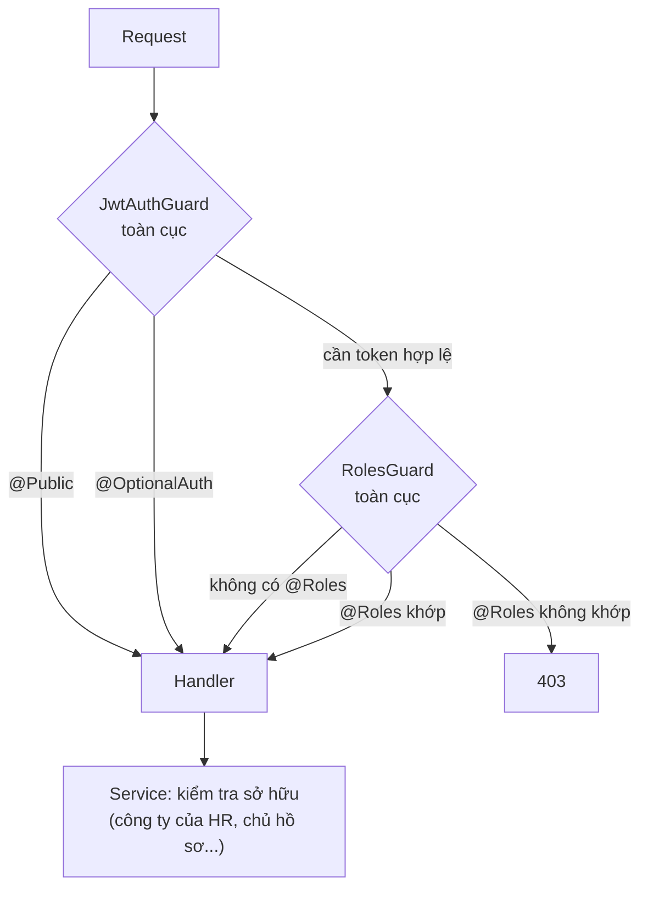

# Vai trò người dùng và quyền truy cập

Tài liệu này mô tả ba vai trò của DevLink và quyền thực tế của từng vai trò. Dữ liệu lấy từ guard, decorator và service, không sao chép từ README.

## Ba vai trò

Vai trò là enum `ERole` trong [role.enum.ts](../../src/casl/enums/role.enum.ts), lưu ở `users.role`:

| Vai trò | Giá trị | Ai dùng |
|---|---|---|
| Ứng viên | `NORMAL USER` | Người tìm việc |
| Nhà tuyển dụng | `HR` | Nhân sự của một công ty, gắn với công ty qua `users.company` |
| Quản trị viên | `SUPER ADMIN` | Vận hành hệ thống |

Đăng ký công khai và đăng nhập Google lần đầu luôn tạo tài khoản `NORMAL USER` ([users.service.ts](../../src/users/users.service.ts) gán cứng `ERole.NORMAL_USER` ở cả hai luồng). HR và quản trị viên do quản trị viên tạo qua `POST /api/v1/users`.

## Cơ chế phân quyền thực tế

Có ba lớp, theo thứ tự:

1. **Đăng nhập (`JwtAuthGuard`)**: mọi route cần JWT trừ khi gắn `@Public()`. `@OptionalAuth()` cho phép khách nhưng nhận biết người dùng nếu có token. Lỗi trả `401` với thông báo "Token không hợp lệ hoặc đã hết hạn" ([jwt-auth.guard.ts](../../src/auth/guards/jwt-auth.guard.ts)).
2. **Vai trò (`RolesGuard`)**: nếu route có `@Roles(...)` thì `user.role` phải nằm trong danh sách, ngược lại bị từ chối. Route không có `@Roles` thì cho qua ([roles.guard.ts](../../src/casl/guards/roles.guard.ts)).
3. **Sở hữu (service)**: nhiều quy tắc nằm trong service, ví dụ HR chỉ sửa công ty và hồ sơ của công ty mình.

### Known Limitation: CASL được định nghĩa nhưng không thực thi

[casl-ability.factory.ts](../../src/casl/casl-ability.factory.ts) mô tả ma trận quyền chi tiết (ví dụ HR `CREATE/READ/UPDATE/DELETE` trên `Job`), và có `PoliciesGuard` cùng decorator `@CheckPolicies`. Nhưng:

- không controller nào dùng `@CheckPolicies` (`grep` toàn `src/` cho kết quả rỗng ngoài `src/casl/`),
- `PoliciesGuard` và `CaslAbilityFactory` không được tham chiếu ở đâu ngoài `src/casl/`,
- guard toàn cục chỉ gồm `JwtAuthGuard` và `RolesGuard` ([app.setup.ts](../../src/app.setup.ts)).

Vì vậy ma trận CASL **không ảnh hưởng** đến quyền thực tế hiện tại. Quyền thật đến từ `@Roles` và kiểm tra trong service. `AGENTS.md` hướng dẫn dùng `@CheckPolicies()`, nhưng code hiện không làm vậy. Hai nguồn này có thể lệch nhau mà không ai phát hiện, vì CASL không được kiểm thử bởi chính hành vi của route.

## Ma trận quyền theo nhóm route

Rút từ decorator của 116 route. `Có` nghĩa là được phép, `Một phần` nghĩa là có thêm điều kiện sở hữu ở service. Chi tiết từng route nằm ở `05-api/endpoints/` (Phase 3).

| Nhóm | Khách | Ứng viên | HR | Quản trị viên |
|---|---|---|---|---|
| Đăng ký, đăng nhập, quên mật khẩu, làm mới token | Có | — | — | — |
| Hồ sơ tài khoản, phiên, đổi mật khẩu, xóa tài khoản | Không | Có | Có | Có |
| Xem tin tuyển dụng (`GET /jobs`) | Có (tin công khai) | Có | Có (tin công ty mình, mọi trạng thái) | Có (tất cả) |
| Đăng, sửa, xóa tin | Không | Không | Một phần (tin công ty mình) | Có |
| Duyệt tin (`PATCH /jobs/:id/approve`) | Không | Không | Không | Có |
| Xem công ty | Có | Có | Có | Có |
| Tạo, xóa công ty | Không | Không | Không | Có |
| Sửa công ty | Không | Không | Một phần (công ty mình) | Có |
| Nộp hồ sơ (`cv-online`, `upload-cv`) | Không | Có | Có | Có |
| Quản lý hồ sơ ứng tuyển (`/resumes` CRUD) | Không | Không | Một phần (hồ sơ công ty mình) | Có |
| Xem phân tích hồ sơ (`/resumes/:id/analysis`) | Không | Một phần (hồ sơ của mình) | Không (chỉ chủ hồ sơ hoặc quản trị viên) | Có |
| CV trực tuyến của mình (`/cv-profiles/me`) | Không | Có | Có | Có |
| Chat AI | Không | Có (30 lượt/ngày) | Có (100 lượt/ngày) | Có (không giới hạn) |
| Thống kê quản trị | Không | Không | Không | Có |
| Thống kê HR (`/statistics/hr-dashboard`) | Không | Không | Có | Không (route chỉ cho `HR`) |
| Quản lý người dùng, kỹ năng, nguồn tin | Không | Không | Không | Có |
| Đăng ký nhận gợi ý, lưu tin, theo dõi công ty, thông báo | Không | Có | Có | Có |
| Tìm kiếm hợp nhất (`/job-search`) | Có | Có | Có | Có |
| Upload file (`avatar`, `cv`, `resumes`) | Không | Có | Có | Có |
| Upload file thư mục `company` | Không | Không | Có | Có |
| Xóa file | Không | Không | Có | Có |

Hạn mức chat lấy từ [chat.constant.ts](../../src/chat/constants/chat.constant.ts) và chính sách ở [chat-quota-policies](../04-database/collections/chat-quota-policies.md).

## Known Limitation: CV của mọi người dùng đọc được bởi bất kỳ ai đã đăng nhập

Hai route dưới đây chỉ yêu cầu đăng nhập, không kiểm tra vai trò hay quyền sở hữu:

| Route | Hành vi |
|---|---|
| `GET /api/v1/cv-profiles` | Trả danh sách phân trang **toàn bộ** CV trực tuyến |
| `GET /api/v1/cv-profiles/:id` | Trả CV của bất kỳ ai khi biết `_id` |

Bằng chứng: [cv-profiles.controller.ts](../../src/cv-profiles/cv-profiles.controller.ts) chỉ có `@UseGuards(JwtAuthGuard)` ở cấp class. Handler không có `@Roles`. `findAll` và `findById` trong [cv-profiles.service.ts](../../src/cv-profiles/cv-profiles.service.ts) không lọc theo người gọi. Chính comment trong controller ghi *"Add @Roles('ADMIN') decorator when implementing RBAC"* và mô tả Swagger ghi *"Implement RBAC guard before production use"*.

CV chứa họ tên, điện thoại, email, ngày sinh và địa chỉ (xem [cv-profiles](../04-database/collections/cv-profiles.md)). Đây là rủi ro lộ dữ liệu cá nhân (kiểu BOLA, Broken Object Level Authorization). Trạng thái: đã xác minh bằng đọc mã; **chưa** thử gọi API thực tế vì chưa chạy được MongoDB. Việc sửa nằm ngoài phạm vi dự án tài liệu và chưa được thực hiện.

## Ghi chú về xác thực

- Lỗi sai quyền ở một số nơi trả `400` thay vì `403`, ví dụ `GET /resumes/:id/analysis` và `GET /companies/:id` của HR ném `BadRequestException`. Client không nên dựa vào mã `403` để nhận biết thiếu quyền.
- Quy tắc ngày hết hạn token, cookie refresh và khóa tài khoản nằm ở `08-security` (Phase 4).
