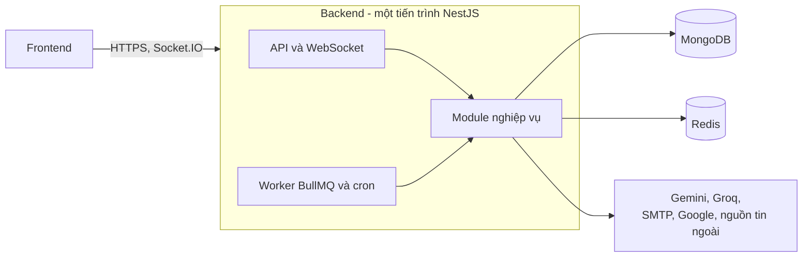

# Tổng quan kiến trúc

DevLink Backend là một ứng dụng NestJS dạng **modular monolith**: một tiến trình duy nhất chia thành nhiều module nghiệp vụ, chạy cả API, WebSocket, worker hàng đợi và cron. Tài liệu này là điểm vào cho nhóm tài liệu kiến trúc.

## Bức tranh tổng thể

## Các nguyên tắc thiết kế quan sát được

| Nguyên tắc | Biểu hiện trong code | Chi tiết |
|---|---|---|
| Mọi route cần xác thực mặc định | `JwtAuthGuard` và `RolesGuard` đăng ký toàn cục, route công khai phải gắn `@Public()` | [component-diagram.md](component-diagram.md) |
| Controller mỏng, logic ở service | Quy ước trong `AGENTS.md`, cấu trúc module chuẩn | [project-structure.md](../00-getting-started/project-structure.md) |
| Việc chậm đi qua hàng đợi | Bảy hàng đợi BullMQ, giới hạn tốc độ theo trần của nhà cung cấp AI | [data-flow.md](data-flow.md) |
| AI hỗ trợ, backend quyết định | Chấm điểm bằng code riêng, không gọi AI | [technology-decisions.md](technology-decisions.md) |
| Fail fast khi thiếu cấu hình | Kiểm tra biến môi trường lúc khởi động | [technology-decisions.md](technology-decisions.md) |
| Xóa mềm | Plugin gắn cho mọi kết nối Mongoose | [component-diagram.md](component-diagram.md) |

## Chỉ số nhanh

Các số dưới đây đếm trực tiếp từ source tại thời điểm viết (2026-11-05).

| Mục | Số lượng | Cách đếm |
|---|---|---|
| File module | 29 | `*.module.ts` |
| Controller | 17 | `*.controller.ts` |
| Route HTTP | 116 | Decorator `@Get`, `@Post`, `@Put`, `@Patch`, `@Delete` trong controller |
| Collection MongoDB | 17 | Model đăng ký trong `*.module.ts` (18 file schema, trong đó `CompanySnapshot` là tài liệu nhúng) |
| Hàng đợi BullMQ | 7 | `@Processor` |
| Cron | 4 | `@Cron` |
| WebSocket gateway | 1 | `NotificationsGateway`, namespace `/notifications` |
| File unit test | 64 | `*.spec.ts` trong `src/` (file e2e `test/app.e2e-spec.ts` không tính) |

## Mục lục nhóm kiến trúc

| Tài liệu | Trả lời câu hỏi |
|---|---|
| [system-context.md](system-context.md) | Ai dùng hệ thống, hệ thống nói chuyện với dịch vụ ngoài nào? |
| [container-diagram.md](container-diagram.md) | Những tiến trình và kho dữ liệu nào tạo nên hệ thống? |
| [component-diagram.md](component-diagram.md) | Một request đi qua những lớp nào? |
| [module-dependencies.md](module-dependencies.md) | Module nào phụ thuộc module nào? |
| [data-flow.md](data-flow.md) | Việc nào xử lý ngay, việc nào đưa sang hàng đợi? Dữ liệu nằm ở đâu? |
| [technology-decisions.md](technology-decisions.md) | Vì sao dùng công nghệ này? Phần nào có bằng chứng, phần nào là suy luận? |
| [observability.md](observability.md) | Theo dõi hệ thống bằng gì? |
| [scalability.md](scalability.md) | Điều gì cản trở việc chạy nhiều instance? |

## Các vấn đề đã biết ở mức kiến trúc

Tổng hợp từ các tài liệu trên. Mỗi mục có bằng chứng và mức chắc chắn ở tài liệu liên kết.

| Vấn đề | Tài liệu |
|---|---|
| `CACHE_MANAGER` chạy trong bộ nhớ thay vì Redis (đã kiểm chứng), ảnh hưởng token đặt lại mật khẩu và hủy xóa tài khoản | [data-flow.md](data-flow.md#known-limitation-cache_manager-chạy-trong-bộ-nhớ-không-phải-redis) |
| Cron và Socket.IO chưa được thiết kế cho nhiều instance | [scalability.md](scalability.md) |
| File tải lên nằm trên đĩa cục bộ | [scalability.md](scalability.md) |
| Ba script `package.json` trỏ tới file không tồn tại | [local-development.md](../00-getting-started/local-development.md#known-limitation-script-dev-bị-thiếu) |

## Tài liệu sẽ bổ sung

Hàng đợi chi tiết, chiến lược cache và các tính năng chuyên sâu (nhập tin, tìm kiếm hợp nhất, chấm điểm CV, chat AI) nằm ở Phase 3. Bảo mật và vận hành nằm ở Phase 4.
