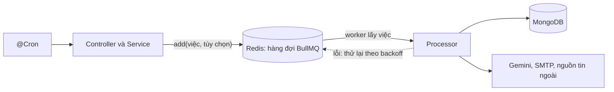

# Xử lý bất đồng bộ: vì sao và như thế nào

Tài liệu này giải thích **vì sao** DevLink đẩy một số việc sang xử lý nền, và những đảm bảo (cùng giới hạn) của cơ chế đó. Chi tiết từng hàng đợi, retry, idempotency ở [queues](../03-modules/queues.md). Tổng quan luồng dữ liệu: [data-flow](data-flow.md).

## Đồng bộ hay bất đồng bộ

*Đồng bộ* nghĩa là request HTTP chờ xong việc mới trả lời. *Bất đồng bộ* nghĩa là request chỉ ghi nhận việc, trả lời ngay, và một worker làm việc đó sau.

| Việc | Cách xử lý | Lý do (từ bằng chứng trong code) |
|---|---|---|
| CRUD, đăng nhập, tìm kiếm, đọc danh sách | Đồng bộ | Nhanh, kết quả cần ngay |
| Nộp hồ sơ bằng CV trực tuyến | Đồng bộ | Dữ liệu CV đã có cấu trúc, chấm điểm bằng code tất định, không gọi AI |
| Nộp hồ sơ bằng file CV | **Bất đồng bộ** | Cần đọc file, gọi Gemini (chậm, chịu giới hạn tốc độ của nhà cung cấp) |
| Đồng bộ nguồn tin ngoài | **Bất đồng bộ** | Tải nhiều trang qua mạng với độ trễ chủ ý, có thể hàng chục giây đến vài phút |
| Gửi email | **Bất đồng bộ** | Phụ thuộc SMTP bên ngoài, có thể chậm hoặc lỗi |
| Xóa tài khoản sau 30 ngày | **Bất đồng bộ, hẹn giờ** | Việc trì hoãn dài, cần hủy được |
| Chat AI | Đồng bộ (stream) | Người dùng cần thấy câu trả lời ngay khi mô hình sinh ra, xem [realtime](../05-api/realtime.md) |

## Vì sao đọc CV đi qua hàng đợi thay vì xử lý trong request

Bằng chứng trong code:

1. **Giới hạn tốc độ của nhà cung cấp.** Processor `resume-processing` khai báo `limiter: { max: 15, duration: 60000 }` với comment "Mirror the current Gemini ... RPM ceiling" ([resume-queue.processor.ts](../../src/queues/processors/resume-queue.processor.ts)), và `GeminiQuotaService` mặc định 15 yêu cầu mỗi phút, 450 mỗi ngày. Hàng đợi là chỗ tự nhiên để **điều tiết** số lần gọi, thay vì để mọi request cùng gọi Gemini một lúc.
2. **Phục hồi khi hết quota.** Khi bị từ chối vì hết quota, việc được lên lịch lại có độ trễ thay vì làm hỏng yêu cầu của người dùng. Điều này không thể làm được nếu đang giữ một request HTTP.
3. **Phản hồi tức thì.** Phản hồi nộp file trả `status: "processing"` ngay và nói rõ dự kiến "30-60 seconds".

Các lý do 1 và 3 được rút ra trực tiếp từ cấu hình và chuỗi trong code. Việc tác giả có chủ ý như vậy hay không không được ghi trong repository, nên đây là kết luận từ bằng chứng chứ không phải ghi chú thiết kế.

## Hàng đợi trong kiến trúc

- Producer và processor **chung một tiến trình** với API.
- Trạng thái việc nằm trong Redis (`REDIS_QUEUE_DB`), nên việc chờ không mất khi khởi động lại tiến trình (khác với lớp cache `CACHE_MANAGER`).

## Đảm bảo và giới hạn

| Thuộc tính | Hiện trạng |
|---|---|
| Không mất việc khi khởi động lại | Có, việc nằm trong Redis. Việc đang chạy dở được BullMQ phát hiện bị kẹt và xử lý theo cơ chế của thư viện; chưa kiểm tra hành vi khi tắt đột ngột |
| Thử lại khi lỗi | Có, 3 lần với backoff mũ cho mọi việc |
| Chống xử lý trùng | **Chỉ** `job-ingestion` và `account-deletion` có `jobId`; phần còn lại thì không |
| Giữ việc lỗi để điều tra | Tùy hàng đợi: một số xóa ngay, một số giữ vô thời hạn |
| Quan sát | Có endpoint thống kê hàng đợi cho `resumes` và `mail`; không có metric tự động ([observability](observability.md)) |
| Scale riêng worker | Không, chung tiến trình |
| Thứ tự | Ưu tiên theo số (`parse` trước `analyze`); trong cùng ưu tiên theo thứ tự vào |

## Thời gian hẹn giờ

BullMQ hỗ trợ việc trễ (`delay`), được dùng ở hai nơi: `delete-account` trễ 30 ngày và `parse-resume` lên lịch lại khi hết quota. Việc trễ lưu trong Redis; nếu Redis mất dữ liệu thì lịch xóa tài khoản **mất theo** (người dùng đã yêu cầu xóa sẽ không bị xóa). Redis trong `docker-compose.prod.yml` bật `--appendonly yes` giúp giảm rủi ro này ([docker-compose.prod.yml](../../docker-compose.prod.yml)).

## Known Limitation

- Worker chung tiến trình với API: tải xử lý nền cạnh tranh tài nguyên với request.
- Hầu hết hàng đợi không có `jobId` loại trùng ([queues](../03-modules/queues.md#idempotency-chống-xử-lý-trùng)).
- Khôi phục sau sự cố Redis: chưa có quy trình được ghi lại; xem `11-operations` (Phase 4).
- Không có hàng đợi "thư chết" (dead-letter) riêng: việc lỗi nằm lại ở trạng thái `failed` của chính hàng đợi.
