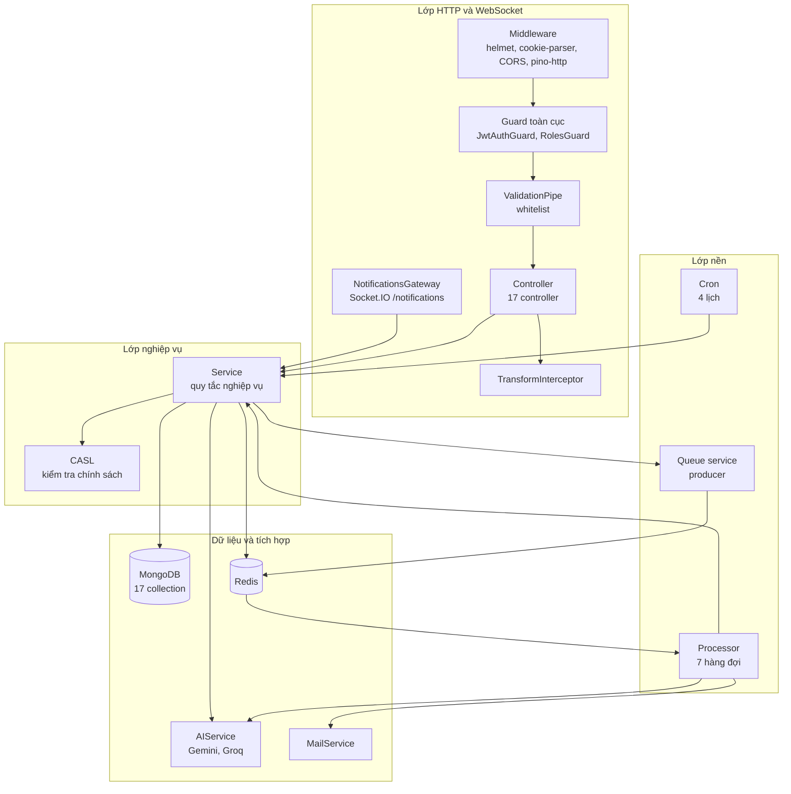
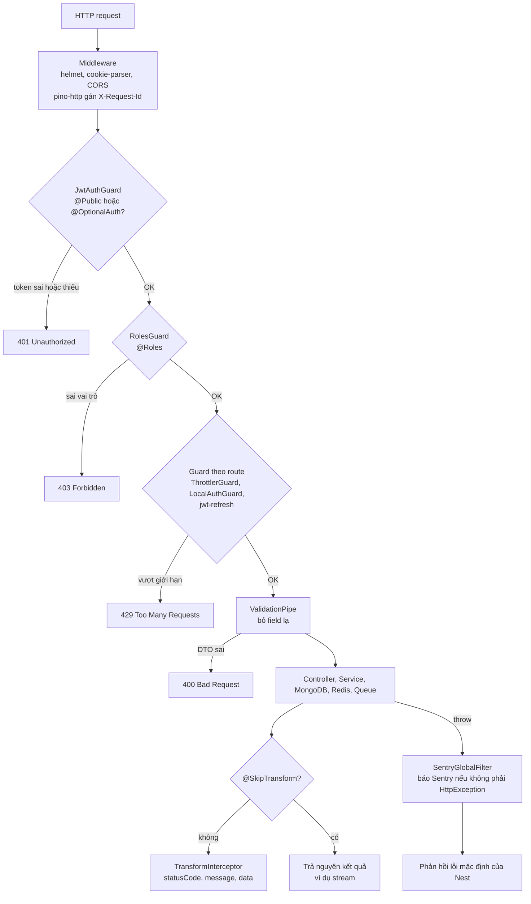

# Component Diagram

Mức 3 của mô hình C4: các thành phần bên trong container `backend` và đường đi của một request. Dùng tài liệu này để biết một request đi qua những lớp nào trước khi tới service.

## Thành phần

Sơ đồ rút gọn các luồng chính. Quan hệ phụ thuộc giữa module: [module-dependencies.md](module-dependencies.md).

## Vòng đời một HTTP request

Thiết lập trong [app.setup.ts](../../src/app.setup.ts) và [app.module.ts](../../src/app.module.ts).

Thứ tự giữa các loại thành phần tuân theo [vòng đời request của NestJS](https://docs.nestjs.com/faq/request-lifecycle): middleware, rồi guard, rồi interceptor và pipe, rồi handler. `configureApp` đăng ký `helmet` đầu tiên để mọi phản hồi đều có header bảo mật, và đăng ký hai guard toàn cục theo thứ tự `JwtAuthGuard` trước `RolesGuard`.

## Những điểm hay vấp

| Chủ đề | Hành vi | Nguồn |
|---|---|---|
| Xác thực mặc định | **Mọi route đều cần JWT** trừ khi gắn `@Public()`. `@OptionalAuth()` dùng cho route công khai nhưng vẫn nhận biết người dùng nếu có token | [src/utils/decorators/](../../src/utils/decorators/) |
| Tiền tố | Mọi route có dạng `/api/v1/...`. Swagger ở `/api` | [app.setup.ts](../../src/app.setup.ts) |
| Cấu trúc phản hồi | Controller chỉ trả dữ liệu. `message` lấy từ `@ResponseMessage`, nếu không có thì là `null` | [transform.interceptor.ts](../../src/utils/transform.interceptor.ts) |
| Rate limit | Ba mức khai báo toàn cục (`burst` 5/giây, `sustained` 20/10 giây, `default` 60/phút) lưu trên Redis, nhưng chỉ có hiệu lực ở controller gắn `ThrottlerGuard`: `auth`, `chat`, `job-search`, `resumes` | [app.module.ts](../../src/app.module.ts) |
| Người dùng hiện tại | Lấy bằng decorator `@User()` | [user.decorator.ts](../../src/utils/decorators/user.decorator.ts) |
| Xóa mềm | Plugin `soft-delete-plugin-mongoose` gắn cho mọi kết nối | [app.module.ts](../../src/app.module.ts) |

Chi tiết xác thực và phân quyền sẽ nằm ở `08-security` và `03-modules/authorization.md`.

## Lưu ý khi thêm route xác thực

Guard riêng của route (`LocalAuthGuard`, `AuthGuard('jwt-refresh')`) không thay thế guard toàn cục. Vì vậy `POST /api/v1/auth/login` và `GET /api/v1/auth/refresh` đều gắn `@Public()` cùng guard riêng ([auth.controller.ts](../../src/auth/auth.controller.ts)). Một route xác thực mới mà thiếu `@Public()` sẽ bị `JwtAuthGuard` toàn cục chặn khi chưa có token.
