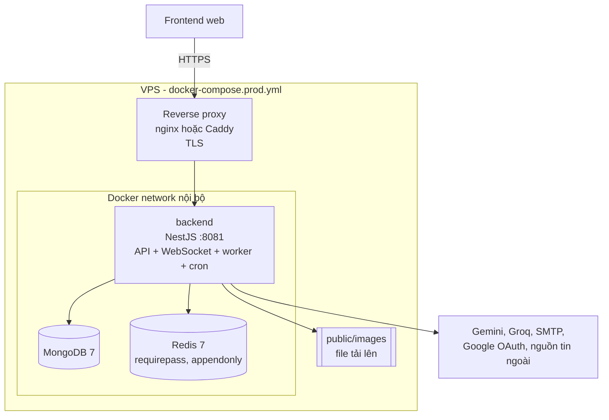

# Container Diagram

Mức 2 của mô hình C4: những tiến trình và kho dữ liệu chạy độc lập tạo nên hệ thống, cùng cách chúng giao tiếp. Trong C4, "container" nghĩa là một tiến trình hoặc kho dữ liệu triển khai được, không nhất thiết là Docker container.

## Sơ đồ triển khai production

## Các container

| Container | Công nghệ | Trách nhiệm | Nguồn cấu hình |
|---|---|---|---|
| `backend` | Node 24, NestJS 10 | REST API, WebSocket, worker BullMQ, cron, tất cả cùng một tiến trình | [Dockerfile](../../Dockerfile), [docker-compose.prod.yml](../../docker-compose.prod.yml) |
| MongoDB | `mongo:7.0` | Lưu toàn bộ dữ liệu nghiệp vụ | [docker-compose.prod.yml](../../docker-compose.prod.yml) |
| Redis | `redis:7-alpine` | Hàng đợi BullMQ, rate limit, cache, quota | [docker-compose.prod.yml](../../docker-compose.prod.yml) |
| Reverse proxy | nginx hoặc Caddy | Kết thúc TLS, chuyển tiếp tới backend | Không nằm trong repository. Xem [DEPLOYMENT.md](../../DEPLOYMENT.md) |

## Giao tiếp giữa các container

| Từ | Tới | Giao thức | Mục đích |
|---|---|---|---|
| Frontend | Backend | HTTPS, Socket.IO namespace `/notifications` | API và thông báo thời gian thực |
| Backend | MongoDB | Giao thức MongoDB qua Mongoose | Đọc, ghi dữ liệu |
| Backend | Redis | ioredis | Hàng đợi (DB `REDIS_QUEUE_DB`, mặc định 0), cache và rate limit (DB `REDIS_CACHE_DB`, mặc định 1) |
| Backend | Ổ đĩa | Hệ thống file | Lưu và serve file tải lên ở `public/` |

## Design Decision: một tiến trình, nhiều vai trò

Cùng một tiến trình NestJS xử lý HTTP, chạy worker BullMQ và chạy cron. Đây là lựa chọn của mã nguồn: `QueuesModule` đăng ký cả producer lẫn processor trong `AppModule`, và các hàm `@Cron` nằm trong service thường.

- Ưu điểm: một đơn vị triển khai, không cần quản lý nhiều service, processor dùng lại trực tiếp service nghiệp vụ.
- Đánh đổi: tải xử lý nền cạnh tranh tài nguyên với API. Muốn scale riêng worker phải tách code. Xem [scalability.md](scalability.md).

## Hạ tầng local

`docker-compose.yml` chỉ chạy MongoDB và Redis, và tùy chọn thêm backend với profile `full`. Cổng được gắn vào `127.0.0.1`. Xem [local-development.md](../00-getting-started/local-development.md).

## Chưa xác minh

- Cấu hình reverse proxy thực tế không có trong repository nên không được mô tả ở đây. `DEPLOYMENT.md` có hướng dẫn, nhưng chưa được đối chiếu với môi trường chạy thật.
