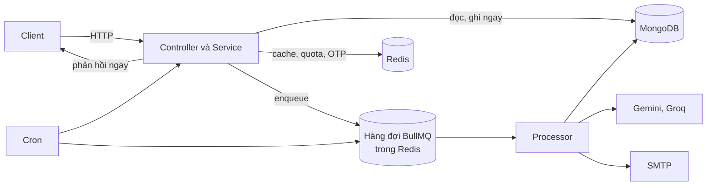

# Luồng dữ liệu: đồng bộ và bất đồng bộ

Tài liệu này phân biệt việc backend xử lý ngay trong request với việc đẩy sang hàng đợi, và chỉ ra dữ liệu đi qua những kho nào. Cơ chế hàng đợi chi tiết (retry, idempotency, phục hồi) sẽ nằm trong `queues.md` ở Phase 3.

## Hai đường xử lý

| Đường | Dùng khi | Ví dụ trong code |
|---|---|---|
| Đồng bộ | Kết quả cần trả cho client ngay, thao tác nhanh | CRUD, đăng nhập, tìm kiếm, danh sách có cache |
| Bất đồng bộ qua hàng đợi | Việc chậm, phụ thuộc dịch vụ ngoài, hoặc phải giới hạn tốc độ | Đọc CV bằng AI, gửi email, đồng bộ nguồn tin, xóa tài khoản sau thời gian chờ |
| Cron | Việc theo lịch | Xem bảng dưới |

## Bảy hàng đợi

Tên hàng đợi lấy từ [queues.constants.ts](../../src/queues/queues.constants.ts). Bảng này chỉ nêu nơi đưa việc vào và vai trò; retry và tham số chi tiết xem ở tài liệu hàng đợi.

| Hàng đợi (`name`) | Ai đưa việc vào | Vai trò |
|---|---|---|
| `resume-processing` | `resumes` | Đọc và phân tích CV của hồ sơ ứng tuyển. Một worker, giới hạn 15 job mỗi 60 giây theo comment trong code là để khớp trần RPM của Gemini |
| `company-follower-notification` | `jobs` | Báo cho người theo dõi công ty khi có tin mới |
| `job-recommendation` | `mail` | Gửi gợi ý việc làm cho người đăng ký. Xử lý song song 5 job |
| `application-notification` | `resumes` (qua `application-notification.service.ts`) | Thông báo liên quan hồ sơ ứng tuyển |
| `job-expiration-notification` | `jobs` (`JobsService` inject producer) | Thông báo tin hết hạn |
| `account-deletion` | `auth` | Xóa tài khoản sau thời gian chờ. `jobId` là `delete-account-<userId>` để hủy được |
| `job-ingestion` | `job-ingestion` | Đồng bộ một nguồn tin. `jobId` là `sync-<sourceKey>` để cron và lần chạy tay không chạy trùng |

Hai hàng đợi `application-notification` và `job-expiration-notification` mới được xác định nơi inject producer, chưa đọc điều kiện đưa việc vào cụ thể. Điều kiện này sẽ được bổ sung ở `queues.md` (Phase 3).

## Cron

| Lịch | Múi giờ | Nơi khai báo | Việc làm |
|---|---|---|---|
| `0 */6 * * *` (mỗi 6 giờ) | `Asia/Ho_Chi_Minh` | [job-ingestion.service.ts](../../src/job-ingestion/job-ingestion.service.ts) | Đưa việc đồng bộ cho từng nguồn đang bật vào hàng `job-ingestion` |
| `0 9 * * 1` (9 giờ sáng thứ Hai) | `Asia/Ho_Chi_Minh` | [mail.controller.ts](../../src/mail/mail.controller.ts) | Đưa việc gợi ý việc làm vào hàng `job-recommendation` |
| `0 * * * *` (mỗi giờ) | `Asia/Ho_Chi_Minh` | [jobs.service.ts](../../src/jobs/jobs.service.ts) | `deactivate-expired-jobs`: đặt `isActive = false` cho tin có `endDate` đã qua, rồi xóa cache liên quan |
| `0 2 * * *` (2 giờ sáng hằng ngày) | `Asia/Ho_Chi_Minh` | [companies.service.ts](../../src/companies/companies.service.ts) | `cleanup-orphaned-company-logos`: xóa file logo không còn được công ty nào tham chiếu |

Cron được khai báo trong một controller (`mail.controller.ts`) chứ không phải service, nên hàm cron nằm cùng file với route HTTP.

## Luồng dữ liệu điển hình

### Nộp hồ sơ và phân tích CV

Đây là ví dụ rõ nhất của cách tách đồng bộ và bất đồng bộ. Sơ đồ chi tiết sẽ nằm ở `06-workflows/sequences/cv-processing.md`.

1. Client nộp hồ sơ, `resumes` lưu bản ghi vào MongoDB và trả lời ngay.
2. `resumes` đưa việc vào hàng `resume-processing` ([resume-processing.service.ts](../../src/resumes/resume-processing.service.ts) gọi `addParseResumeJob` và `addAnalyzeResumeJob`).
3. Processor lấy việc, đọc CV bằng `CvParserService`, gọi `AIService`, chấm điểm bằng `MatchingService` và cập nhật bản ghi.

Lý do thiết kế: đọc CV bằng AI chậm và chịu giới hạn tốc độ của nhà cung cấp, nên không nên giữ request HTTP chờ. Hàng đợi cho phép giới hạn số lần gọi mỗi phút. Nội dung "lý do" này là suy luận từ cấu hình `limiter` và comment trong code, không phải ghi chú thiết kế của tác giả.

### Chat với trợ lý AI

Chat trả lời dạng stream qua `POST /api/v1/chat/message/stream`, nên chạy đồng bộ trong request và không đi qua hàng đợi. Chi tiết ở `ai-chat.md` (Phase 3).

## Nơi lưu dữ liệu

| Kho | Loại dữ liệu | Ghi chú |
|---|---|---|
| MongoDB | Dữ liệu nghiệp vụ bền vững | 17 collection, xóa mềm bằng plugin |
| Redis DB `REDIS_QUEUE_DB` (mặc định 0) | Trạng thái hàng đợi BullMQ | |
| Redis DB `REDIS_CACHE_DB` (mặc định 1) | Rate limit, OTP và quota qua `REDIS_CLIENT`, cache danh sách | Xem Known Limitation bên dưới về `CACHE_MANAGER` (cache danh sách dùng `ListCacheService`, chưa kiểm tra) |
| Ổ đĩa `public/` | File tải lên | Không đồng bộ giữa nhiều instance |
| Bộ nhớ tiến trình | `CACHE_MANAGER`, bản đồ socket của gateway | Mất khi khởi động lại |

## Known Limitation: `CACHE_MANAGER` chạy trong bộ nhớ, không phải Redis

[redis.module.ts](../../src/redis/redis.module.ts) cấu hình `CacheModule` với tùy chọn `store: redisStore`. Phiên bản `@nestjs/cache-manager` đang cài là 3.0.1 và mã nguồn `dist/cache.providers.js` của gói này chỉ đọc `options.stores`, không đọc `options.store`.

**Đã kiểm chứng bằng thực nghiệm (2026-11-05).** Dựng đúng cấu hình `CacheModule` của dự án (cùng `redisStore`, `host`, `db`, `ttl`) trỏ tới một cổng không có Redis, rồi gọi `set` và `get`. Cả hai hoàn tất trong 0 ms và trả đúng giá trị, store là `Keyv`. Nếu dữ liệu thật sự đi qua Redis thì thao tác phải lỗi hoặc quá hạn kết nối. Thực nghiệm không cần chạy MongoDB hay Redis.

**Hệ quả:** dữ liệu đi qua `CACHE_MANAGER` nằm trong bộ nhớ của từng tiến trình, mất khi khởi động lại và không chia sẻ giữa các instance. Nơi đang dùng (tìm bằng `grep CACHE_MANAGER src`):

| Nơi dùng | Dữ liệu | Tác động khi mất cache |
|---|---|---|
| [auth-credentials.service.ts](../../src/auth/services/auth-credentials.service.ts) | Token đặt lại mật khẩu (`reset_password:<token>`) | Link đặt lại mật khẩu đã gửi mail mất hiệu lực sau khi backend khởi động lại |
| [auth-account-deletion.service.ts](../../src/auth/services/auth-account-deletion.service.ts) | Token hủy xóa tài khoản (`cancel_deletion:<token>`), sống **30 ngày** | Link hủy xóa trong email mất hiệu lực khi khởi động lại. Người dùng vẫn hủy được khi đã đăng nhập |
| `src/chat/` (service, context, cache) và `cv-profiles.service.ts` | Cache ngữ cảnh và phản hồi chat | Chỉ chậm hơn, tính lại được |
| `src/statistics/statistics-cache.service.ts`, `skills.service.ts` | Cache thống kê và kỹ năng | Chỉ chậm hơn |

Hai dòng đầu là thay đổi chức năng chứ không chỉ hiệu năng. Phần OTP, quota và rate limit **không** bị ảnh hưởng vì chúng dùng `REDIS_CLIENT` (ioredis) trực tiếp. Cách khắc phục là `Future Improvement`: truyền `stores` đúng với phiên bản thư viện.
