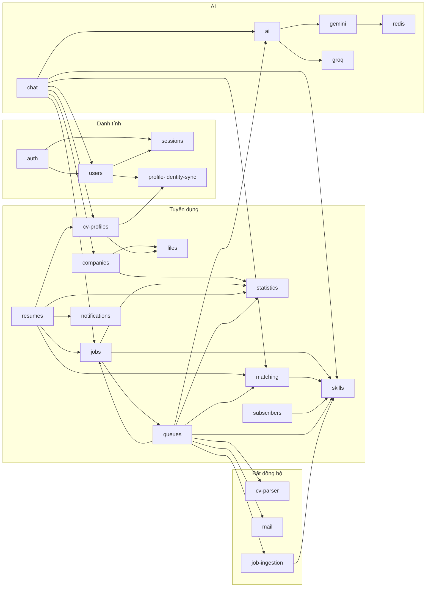

# Phụ thuộc giữa các module

Tài liệu này liệt kê module nào import module nào. Dữ liệu được rút từ mảng `imports` trong từng file `*.module.ts`, bỏ qua các module hạ tầng của framework (`MongooseModule`, `ConfigModule`, `BullModule`, `JwtModule`, `PassportModule`, `CacheModule`, `ThrottlerModule`, `MulterModule`, `MailerModule`).

## Phạm vi của "phụ thuộc"

Có hai loại quan hệ dễ nhầm:

| Loại | Cách nhận biết | Ý nghĩa |
|---|---|---|
| Phụ thuộc module | Có trong `imports` của `*.module.ts` | Module dùng được provider mà module kia `exports` |
| Dùng chung schema | `MongooseModule.forFeature([...])` đăng ký schema của module khác | Module truy cập trực tiếp collection của module khác, không qua service của nó |

Bảng dưới chỉ ghi loại đầu. Loại thứ hai nằm trong tài liệu từng module và tài liệu `04-database/collection-relationships.md` (Phase 2).

## Bảng phụ thuộc

| Module | Import |
|---|---|
| `auth` | users, sessions |
| `users` | sessions, profile-identity-sync |
| `companies` | files, statistics |
| `jobs` | queues, skills, statistics |
| `resumes` | matching, cv-profiles, jobs, notifications, statistics |
| `cv-profiles` | files, profile-identity-sync |
| `job-ingestion` | skills |
| `matching` | skills |
| `subscribers` | skills |
| `chat` | ai, cv-profiles, jobs, users, companies, skills, matching |
| `ai` | gemini, groq |
| `gemini` | redis |
| `queues` | ai, cv-parser, matching, jobs, mail, skills, statistics, job-ingestion |

Các module không import module nghiệp vụ nào khác: `casl`, `cv-parser`, `databases`, `files`, `groq`, `health`, `job-search`, `mail`, `notifications`, `profile-identity-sync`, `redis`, `sessions`, `skills`, `statistics`.

`QueuesModule` và `RedisModule` được khai báo `@Global()`, nên mọi module dùng được queue và Redis mà không cần import tường minh. `AppModule` gọi `QueuesModule.forRoot()`.

## Sơ đồ

Sơ đồ có hai chiều giữa nhóm "Tuyển dụng" và "Bất đồng bộ": `jobs` import `queues` để đưa việc vào hàng đợi, còn `queues` import `jobs` để processor gọi lại service nghiệp vụ. Hai chiều này chạy được vì `QueuesModule` là module động toàn cục, nên không cần `forwardRef`.

## Current Implementation

- Không có `forwardRef` nào trong `src/`. Đã kiểm tra bằng `grep -rln forwardRef src`.
- `queues` là module có nhiều phụ thuộc nhất vì các processor gọi lại service của nhiều module.
- `job-search` không import module nào. Nó tự đăng ký ba schema `Job`, `ExternalJob` và `JobSource` trong [job-search.module.ts](../../src/job-search/job-search.module.ts) và đọc trực tiếp ba collection này, đây là loại quan hệ "dùng chung schema" nói ở trên.

## Chưa xác minh

- Phát biểu "chạy được vì không cần `forwardRef`" là suy luận từ việc `QueuesModule` là `@Global()` và `grep` không thấy `forwardRef`. Chưa chạy thử để xác nhận không có cảnh báo phụ thuộc vòng khi khởi động, vì cần MongoDB và Redis.
- Ghi chú kiến trúc cũ `docs/archive/architecture/01-overview.md` (tài liệu cũ, chỉ có ở local) có bảng phụ thuộc khác bảng này ở nhiều dòng, ví dụ nó ghi `users` phụ thuộc `companies`, `jobs`. Bảng cũ gộp cả schema đăng ký chung, còn bảng này chỉ ghi `imports` thật.
