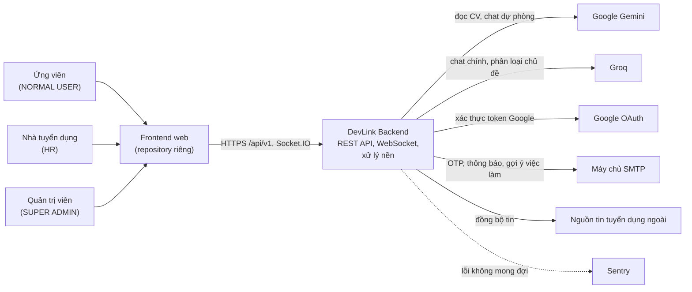

# System Context

Tài liệu này mô tả DevLink Backend trong mối quan hệ với người dùng và các hệ thống bên ngoài (mức 1 của mô hình C4). Mức này trả lời: ai dùng hệ thống, hệ thống phụ thuộc vào dịch vụ nào bên ngoài.

## Sơ đồ

## Giải thích

| Thành phần | Vai trò | Ghi chú |
|---|---|---|
| Ứng viên, HR, quản trị viên | Người dùng cuối, phân biệt bằng `ERole` | Backend không có giao diện, mọi thao tác đi qua frontend |
| Frontend web | Giao diện người dùng | Không nằm trong repository này. Backend chỉ cho phép các origin khai báo trong `CORS_ORIGINS` hoặc `FE_URL` |
| Google Gemini | Đọc CV, và là nhà cung cấp dự phòng cho chat và tóm tắt | Cấu hình ở `GEMINI_*`. Xem `07-integrations/ai-providers.md` khi có |
| Groq | Nhà cung cấp chính cho chat và phân loại chủ đề | Cấu hình ở `GROQ_*` và `AI_*` |
| Google OAuth | Đăng nhập bằng Google | Dùng `google-auth-library` |
| SMTP | Gửi email | Qua `@nestjs-modules/mailer` |
| Nguồn tin ngoài | Cung cấp tin tuyển dụng để đồng bộ | Danh sách nguồn do dữ liệu seed và collection `job_sources` quyết định |
| Sentry | Nhận báo cáo lỗi | Tắt khi không có `SENTRY_DSN` |

## Current Implementation

- Phân vai Gemini và Groq đã đối chiếu với code. [ai.constants.ts](../../src/ai/ai.constants.ts) đặt Groq là nhà cung cấp chính mặc định cho chat và tóm tắt, và bật dự phòng sang Gemini theo mặc định. Cả hai đổi được bằng biến `AI_CHAT_PRIMARY_PROVIDER`, `AI_SUMMARY_PRIMARY_PROVIDER` và các biến `*_GEMINI_FALLBACK_ENABLED`. Việc đọc CV luôn gọi Gemini qua [ai.service.ts](../../src/ai/ai.service.ts). Logic chọn nhà cung cấp chi tiết sẽ nằm ở tài liệu tích hợp AI (Phase 3).
- Tên các nguồn tin ngoài cụ thể chưa được liệt kê ở đây vì chưa đối chiếu với dữ liệu seed và adapter. Trạng thái: `Chưa xác minh`.

## Đọc tiếp

- Các container bên trong hệ thống: [container-diagram.md](container-diagram.md)
