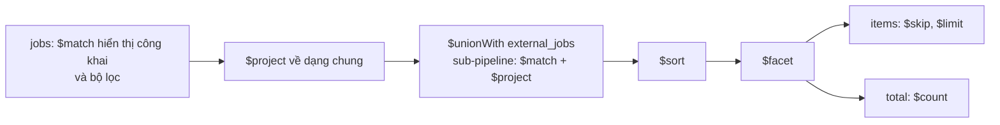

# Module Job Search (tìm kiếm hợp nhất)

## Overview

Một API tìm việc duy nhất trên **hai nguồn dữ liệu khác nhau**: tin nội bộ ([jobs](../04-database/collections/jobs.md)) và tin lấy từ nguồn ngoài ([external-jobs](../04-database/collections/external-jobs.md)). Người dùng nhận một danh sách phân trang, sắp xếp và lọc chung, không cần biết tin đến từ đâu. API ở [job-search endpoints](../05-api/endpoints/job-search.md); sơ đồ trình tự ở [unified-job-search](../06-workflows/sequences/unified-job-search.md).

## Responsibilities

- Chuẩn hóa và kiểm tra tham số tìm kiếm.
- Xây một pipeline aggregation duy nhất ghép hai collection.
- Áp dụng quy tắc hiển thị: chỉ tin nội bộ công khai, chỉ tin ngoài đang hiển thị và nguồn không bị ẩn.
- Trả chi tiết một tin ngoài, tôn trọng `displayPolicy` của nguồn.

## Architecture

| Thành phần | File | Vai trò |
|---|---|---|
| Controller (2 route) | [job-search.controller.ts](../../src/job-search/job-search.controller.ts) | Công khai, có `ThrottlerGuard` |
| Service | [job-search.service.ts](../../src/job-search/job-search.service.ts) | Chuẩn hóa tham số, chạy pipeline, chi tiết tin ngoài |
| Xây pipeline | [job-search-pipeline.ts](../../src/job-search/job-search-pipeline.ts) | Hàm thuần dựng các stage, có test riêng |
| Hằng số | [job-search.constants.ts](../../src/job-search/job-search.constants.ts) | `source`, `sort`, giới hạn |
| Hiển thị tin nội bộ | [job-visibility.util.ts](../../src/jobs/job-visibility.util.ts) | Dùng chung với `jobs` |

## Dependencies

Module không import module nào; tự đăng ký ba schema `Job`, `ExternalJob`, `JobSource` ([job-search.module.ts](../../src/job-search/job-search.module.ts)) và đọc trực tiếp các collection này.

## Cách pipeline hoạt động

Pipeline chạy trên collection `jobs` và ghép `external_jobs` bằng `$unionWith`:

Mỗi phía được chiếu về cùng một dạng (`IJobSearchItem`) trước khi ghép; trường chỉ có ở một phía để trống ở phía kia. Chi tiết trường: [job-search endpoint](../05-api/endpoints/job-search.md#phản-hồi-danh-sách).

### Bộ lọc áp dụng cho từng phía

| Bộ lọc | Tin nội bộ | Tin ngoài |
|---|---|---|
| Hiển thị | `isActive`, `APPROVED`, còn hạn (`buildPublicJobVisibilityFilter`), và `isDeleted: { $ne: true }` | `status` thuộc `ACTIVE`, `STALE`; `expiresAt` chưa qua hoặc rỗng; loại nguồn `HIDDEN` |
| `keyword` | Regex không phân biệt hoa thường trên `name`, `skills`, `company.name` | Regex trên `title`, `skills`, `companyName` |
| `locationCode` | So bằng | So bằng |
| `level` | So bằng | So bằng |
| `formOfWork` | So bằng | Chỉ khi `Remote`: tin ngoài `isRemote = true`. Giá trị khác: **loại hẳn phía ngoài** |
| `salaryMin`, `salaryMax` | `salary` trong khoảng | **Loại hẳn phía ngoài** (tin ngoài không có lương dạng số) |

Hệ quả: khi `source=all` và có lọc lương hoặc hình thức khác `Remote`, kết quả chỉ gồm tin nội bộ mà **không báo** cho người gọi. Khi `source=external` mà lọc không thể thỏa mãn thì trả danh sách rỗng (`target: 'empty'`).

### Sắp xếp

| `sort` | Thứ tự |
|---|---|
| `newest` (mặc định) | `postedAt` giảm dần, rồi `id` |
| `oldest` | `postedAt` tăng dần |
| `salary_desc`, `salary_asc` | Có lương trước (`hasSalary`), rồi `salary`, rồi `postedAt` |

Trường `hasSalary` (1 cho tin nội bộ, 0 cho tin ngoài) đưa tin không có lương xuống cuối ở cả hai chiều sắp xếp. `id` làm khóa phụ để thứ tự ổn định giữa các trang.

### Phân trang

`$facet` tính cùng lúc `items` (`$skip`, `$limit`) và `total` (`$count`). `limit` tối đa 50, mặc định 10. Kết quả theo dạng `{ result, meta.pagination }`.

## Business Rules

| Quy tắc | Chi tiết |
|---|---|
| Tin nội bộ chỉ khi đã duyệt | Dùng chung bộ lọc hiển thị với `GET /jobs` |
| Nguồn `HIDDEN` | Loại khỏi danh sách (lấy `distinct('key', { displayPolicy: 'HIDDEN' })` mỗi lần tìm) và `404` ở chi tiết |
| Nguồn `LINK_ONLY` | Danh sách chỉ có liên kết; mô tả rỗng ở chi tiết. Nguồn cũ chưa có `displayPolicy` được coi là `LINK_ONLY` (`DEFAULT_DISPLAY_POLICY`) |
| `salaryMin > salaryMax` | `400` "salaryMin must not be greater than salaryMax" |
| ID không hợp lệ ở chi tiết | `400` "Invalid ID format" |
| Tin ngoài `STALE` | Hiển thị bình thường; chi tiết trả `ACTIVE` |
| Tin ngoài `CLOSED` hoặc `expiresAt` đã qua | Chi tiết trả `CLOSED` (đóng với công chúng ngay cả trước lần đồng bộ kế tiếp) |

`aggregate()` bỏ qua plugin xóa mềm, nên pipeline nội bộ tự thêm `isDeleted: { $ne: true }` (comment trong code), xem [database-overview](../04-database/database-overview.md#known-limitation-xóa-mềm-không-tự-áp-dụng-cho-mọi-loại-truy-vấn).

## Error Handling

`400` cho tham số sai (qua `ValidationPipe` và kiểm tra trong service), `404` cho tin ngoài không tồn tại hoặc bị ẩn, `429` khi vượt giới hạn tốc độ.

## Known Limitation

- **Không cache.** Code ghi chú `shortcut: uncached aggregate, add ListCacheService with ingestion-sync invalidation if p95 latency grows`. Mỗi lần tìm chạy một aggregation trên cả hai collection.
- **Tìm từ khóa bằng regex không neo đầu** (`/keyword/i` sau khi thoát ký tự đặc biệt) nên không tận dụng được index và quét rộng. Index văn bản `{ name: text, description: text }` của `jobs` không được dùng ở đây. Hiệu năng khi dữ liệu lớn: `Chưa xác minh`.
- **`$sort` sau `$unionWith`** phải sắp xếp toàn bộ tập kết quả, không dùng index. Pipeline không đặt `allowDiskUse`, nên có thể chạm giới hạn bộ nhớ của MongoDB cho `$sort` khi tập dữ liệu rất lớn. Chưa đo, `Chưa xác minh`.
- Việc loại im lặng tin ngoài khi có lọc lương hoặc hình thức khác `Remote` có thể gây bất ngờ cho giao diện; API không trả cờ nào báo điều này.
- Giới hạn tốc độ `ThrottlerGuard` dùng IP; cần `TRUST_PROXY` đúng khi chạy sau proxy ([component-diagram](../02-architecture/component-diagram.md)).

## Testing

Có test cho `buildJobSearchPlan` và các hàm dựng stage ([job-search-pipeline.spec.ts](../../src/job-search/job-search-pipeline.spec.ts)) và cho service ([job-search.service.spec.ts](../../src/job-search/job-search.service.spec.ts)). Chưa chạy pipeline với MongoDB thật.

## Source References

[src/job-search/](../../src/job-search/), [job-visibility.util.ts](../../src/jobs/job-visibility.util.ts).
