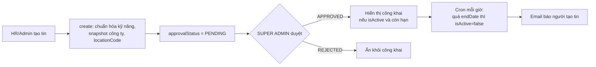

# Module Jobs

## Overview

Quản lý tin tuyển dụng nội bộ: tạo, sửa, xóa, duyệt, lọc theo quyền xem, tự hết hạn, và cung cấp dữ liệu cho chat và thống kê.

## Responsibilities

- CRUD tin với chuẩn hóa kỹ năng và địa điểm.
- Quyết định ai xem được tin nào.
- Duyệt hoặc từ chối tin (quản trị viên).
- Cron tắt tin hết hạn và thông báo.
- Đưa việc thông báo "tin mới" cho người theo dõi công ty vào hàng đợi.

## Architecture

| Thành phần | File |
|---|---|
| Controller (7 route, `/api/v1/jobs`) | [jobs.controller.ts](../../src/jobs/jobs.controller.ts) |
| Service | [jobs.service.ts](../../src/jobs/jobs.service.ts) |
| Repository | [job.repository.ts](../../src/jobs/repositories/job.repository.ts) |
| Quy tắc hiển thị | [job-visibility.util.ts](../../src/jobs/job-visibility.util.ts) |
| Enum | `EJobLevel`, `EJobFormOfWork`, `EJobApprovalStatus` trong [enums/](../../src/jobs/enums/) |

## Dependencies

Import `queues` (đưa việc vào hàng đợi), `skills` (chuẩn hóa kỹ năng), `statistics` (xóa cache). `companies` cung cấp snapshot qua repository; `resumes`, `chat`, `job-search` đọc tin.

## Business Rules

Đầy đủ ở [jobs (collection)](../04-database/collections/jobs.md#quy-tắc-nghiệp-vụ) và [business-rules](../01-product/business-rules.md). Tóm tắt:

- Tin mới `PENDING`, công khai chỉ khi `isActive`, `APPROVED` và còn hạn.
- HR chỉ thấy tin của công ty mình, quản trị viên thấy tất cả.
- Chỉ `SUPER ADMIN` được duyệt; chỉ đặt được `APPROVED` hoặc `REJECTED` và không kiểm tra trạng thái trước, nên không quay lại `PENDING`.
- Kỹ năng và địa điểm được chuẩn hóa hoặc bị từ chối khi tạo và sửa.
- Mỗi lần tạo tin, `create` luôn đưa một việc vào hàng đợi `company-follower-notification`. Lỗi khi đưa vào hàng đợi chỉ được log, không làm thất bại việc tạo tin.

## Data Model

Collection [jobs](../04-database/collections/jobs.md), snapshot công ty nhúng.

## API

7 route: `POST`, `GET` danh sách (`@OptionalAuth`), `GET :id`, `PATCH :id`, `DELETE :id`, `DELETE bulk`, `PATCH :id/approve`. Danh sách dùng thư viện `api-query-params` (`aqp`) để đọc bộ lọc và sắp xếp từ query string, sau đó lọc qua `sanitizeAqpQuery` để loại toán tử nguy hiểm. Chi tiết ở `05-api/endpoints/jobs.md` (Phase 3).

## Processing Flow

Sơ đồ trạng thái chi tiết sẽ nằm ở `06-workflows/state-machines/` (Phase 3).

## Error Handling

`404` khi không có tin, `400` với ID không hợp lệ hoặc kỹ năng/địa điểm không hợp lệ.

## Known Limitation

- Sửa tin đã duyệt không đặt lại `PENDING`.
- **Email "tin mới" gửi trước khi tin được duyệt.** Hàng đợi được kích hoạt ngay trong `create`, và [company-follower-queue.processor.ts](../../src/queues/processors/company-follower-queue.processor.ts) chỉ lọc người theo dõi (`isActive`, chưa xóa mềm), không kiểm tra `approvalStatus` của tin. Người theo dõi có thể nhận email về tin chưa được duyệt hoặc sau đó bị từ chối. Processor cũng nuốt lỗi gửi từng email (`catch` không ném lại), nên email lỗi không được retry.
- Chi tiết và bằng chứng ở [jobs (collection)](../04-database/collections/jobs.md#lưu-ý).

## Testing

2 file test (`jobs.service.spec.ts`, `job-visibility.util.spec.ts`).

## Source References

[src/jobs/](../../src/jobs/).
