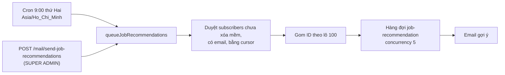

# Module Notifications, Mail và Subscribers

Ba module liên quan đến việc báo tin cho người dùng: thông báo trong ứng dụng (kèm thời gian thực), email, và đăng ký nhận gợi ý việc làm.

## Overview

| Module | Vai trò |
|---|---|
| `notifications` | Lưu thông báo, đánh dấu đã đọc, đẩy thời gian thực qua Socket.IO |
| `mail` | Gửi email theo template; chứa cron gửi gợi ý việc làm hằng tuần |
| `subscribers` | Lưu đăng ký nhận gợi ý việc làm theo kỹ năng và địa điểm |

## Architecture

| Thành phần | File |
|---|---|
| Controller thông báo (5 route) | [notifications.controller.ts](../../src/notifications/notifications.controller.ts) |
| Service thông báo | [notifications.service.ts](../../src/notifications/notifications.service.ts) |
| Gateway Socket.IO | [notifications.gateway.ts](../../src/notifications/notifications.gateway.ts) |
| Mail service | [mail.service.ts](../../src/mail/mail.service.ts) |
| Mail controller (cron, 1 route) | [mail.controller.ts](../../src/mail/mail.controller.ts) |
| Controller đăng ký (7 route) | [subscribers.controller.ts](../../src/subscribers/subscribers.controller.ts) |
| Service đăng ký | [subscribers.service.ts](../../src/subscribers/subscribers.service.ts) |

## Thông báo thời gian thực

`NotificationsGateway` là gateway Socket.IO ở namespace `/notifications`.

| Hạng mục | Chi tiết |
|---|---|
| Xác thực | Token JWT truyền qua `handshake.auth.token`, hoặc header `Authorization: Bearer ...`. Xác minh bằng `JWT_ACCESS_TOKEN_SECRET`. Không có token hoặc token sai thì ngắt kết nối |
| Phòng | Mỗi người dùng vào phòng `user_<userId>`, nên nhiều thiết bị cùng nhận |
| Theo dõi kết nối | `Map<userId, Set<socketId>>` trong bộ nhớ tiến trình |
| CORS | `origin: true`, `credentials: true` |

Sự kiện cụ thể mà server phát (tên event, payload) được ghi ở `05-api/realtime.md` (Phase 3).

**Known Limitation:** `origin: true` cho phép mọi origin kết nối; phần xác thực vẫn bắt buộc token hợp lệ. Bản đồ socket nằm trong bộ nhớ và không có adapter Redis, nên với nhiều instance chỉ socket trên cùng instance nhận được thông báo ([scalability](../02-architecture/scalability.md)).

## Email

`MailService` gửi email bằng template Handlebars trong [src/mail/templates/](../../src/mail/templates/) (8 template: `account-deleted`, `account-deletion-scheduled`, `application-status-update`, `forgot-password`, `job-expired-notification`, `job-recommendation`, `new-job-notification`, `verify-email`). Năm phương thức có trong `MailService`:

| Phương thức | Template | Khi nào |
|---|---|---|
| `sendNewJobNotificationToFollower` | `new-job-notification` | Có tin mới của công ty đang theo dõi |
| `sendApplicationStatusUpdate` | `application-status-update` | Trạng thái hồ sơ đổi |
| `sendJobExpiredNotification` | `job-expired-notification` | Tin hết hạn |
| `sendAccountDeletionScheduled` | `account-deletion-scheduled` | Đặt lịch xóa tài khoản |
| `sendAccountDeleted` | `account-deleted` | Tài khoản đã bị xóa |

Các template `verify-email`, `forgot-password` (OTP và đặt lại mật khẩu) và `job-recommendation` được gọi từ `auth` và từ processor gợi ý việc làm; tên phương thức gửi chúng chưa được liệt kê ở đây. Email thường đi qua hàng đợi (xem [data-flow](../02-architecture/data-flow.md#bảy-hàng-đợi)). Cấu hình SMTP: `SMTP_HOST`, `SMTP_EMAIL`, `SMTP_PASSWORD`.

## Gợi ý việc làm hằng tuần

- Cron và route thủ công dùng chung `queueJobRecommendations`: duyệt toàn bộ `subscribers` chưa xóa mềm và có email, gom ID theo lô 100 rồi đưa vào hàng đợi.
- Route thủ công trả về chỉ số hàng đợi (`getQueueMetrics`).
- Cách chọn tin gợi ý cho từng người (khớp kỹ năng, địa điểm) nằm trong processor, mô tả ở `queues.md` (Phase 3).
- **Known Limitation:** cron nằm trong một controller và không có khóa phân tán; với nhiều instance nó chạy nhiều lần ([scalability](../02-architecture/scalability.md)). Chưa xác minh `addSubscribersToQueueBatch` có `jobId` cố định để loại trùng không.

## Subscribers

Quy tắc đã nêu ở [subscribers (collection)](../04-database/collections/subscribers.md#quy-tắc-nghiệp-vụ): tối đa 3 đăng ký đang hoạt động mỗi người, cần địa điểm hợp lệ, mọi truy cập theo chủ sở hữu (`findOneOwned` theo `createdBy._id`). `POST /subscribers/skills` và `GET /subscribers/by-user` phục vụ giao diện.

## Data Model

Collection [notifications](../04-database/collections/notifications.md), [subscribers](../04-database/collections/subscribers.md).

## Error Handling

Gửi email lỗi trong processor chỉ được log, không retry từng email (xem [jobs](jobs.md#known-limitation)). Tạo thông báo lỗi khi đổi trạng thái hồ sơ chỉ được log và không làm thất bại cập nhật.

## Testing

`notifications/` và `mail/` không có file test. `subscribers/` có 3 file test.

## Source References

[src/notifications/](../../src/notifications/), [src/mail/](../../src/mail/), [src/subscribers/](../../src/subscribers/).
