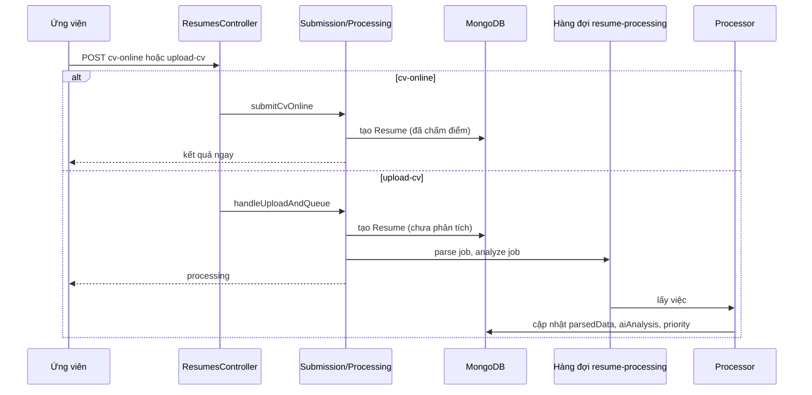

# Module Resumes

## Overview

Quản lý hồ sơ ứng tuyển. Nhận hồ sơ theo hai đường (CV trực tuyến hoặc tải file), lưu kết quả phân tích, cho nhà tuyển dụng xử lý và cho ứng viên xem điểm của mình.

## Responsibilities

- Nộp hồ sơ bằng CV trực tuyến, chấm điểm ngay.
- Nhận file CV, lưu và đưa việc đọc, phân tích vào hàng đợi.
- CRUD hồ sơ cho `HR` và `SUPER ADMIN`, đổi trạng thái kèm lịch sử và thông báo.
- Cho phép chạy lại đọc hoặc phân tích (`reparse`, `reanalyze`).

## Architecture

| Thành phần | File | Vai trò |
|---|---|---|
| Controller (14 route) | [resumes.controller.ts](../../src/resumes/resumes.controller.ts) | `/api/v1/resumes` |
| Service chính | [resumes.service.ts](../../src/resumes/resumes.service.ts) | CRUD, lọc theo quyền, đổi trạng thái |
| Nộp bằng CV trực tuyến | [application-submission.service.ts](../../src/resumes/services/application-submission.service.ts) | Chấm điểm trong request |
| Nhận file | [resume-processing.service.ts](../../src/resumes/resume-processing.service.ts) | Kiểm tra, lưu bản ghi, đưa vào hàng đợi |
| Thông báo | [application-notification.service.ts](../../src/resumes/services/application-notification.service.ts) | Tạo thông báo và đưa email vào hàng đợi |
| Repository | [resume.repository.ts](../../src/resumes/repositories/resume.repository.ts) | Truy cập dữ liệu |

## Dependencies

Import `matching`, `cv-profiles`, `jobs`, `notifications`, `statistics`. Hàng đợi `resume-processing` do `queues` quản lý (processor gọi lại `cv-parser`, `ai`, `matching`).

## Business Rules

Quy tắc trạng thái, ưu tiên, trùng đơn, phạm vi HR đã nêu chi tiết ở [resumes (collection)](../04-database/collections/resumes.md#quy-tắc-nghiệp-vụ). Bổ sung:

| Đường nộp | Route | Giới hạn | Xử lý |
|---|---|---|---|
| CV trực tuyến | `POST /resumes/cv-online` | 10 lần mỗi 5 phút | Cần CV đang bật. Chấm điểm đồng bộ, đặt `isParsed` và `isAnalyzed` |
| Tải file | `POST /resumes/upload-cv` | 20 lần mỗi giờ | Kiểm tra file, tin và trùng đơn, tạo bản ghi, đưa việc `parse` rồi `analyze` vào hàng đợi. Phản hồi `status: 'processing'`, dự kiến 30 đến 60 giây (chuỗi trong code) |

Truy vấn danh sách: `ALLOWED_SORT_FIELDS` giới hạn sắp xếp ở `status`, `priority`, `createdAt`, `updatedAt`, `aiAnalysis.matchingScore`. Có tập toán tử bị chặn (ví dụ `$expr`, `$accumulator`, `$jsReduce`) để tránh truy vấn nguy hiểm từ query string.

Sau khi đổi trạng thái, `sendStatusChangeNotification` chạy bất đồng bộ; lỗi chỉ được log, không làm thất bại cập nhật.

## Data Model

Collection [resumes](../04-database/collections/resumes.md), đọc thêm [cv-profiles](../04-database/collections/cv-profiles.md) (nguồn của `cvStructuredData`).

## API

14 route. Nhóm quản trị (`POST`, `GET`, `PATCH`, `DELETE`, `reparse`, `reanalyze`) cho `HR` và `SUPER ADMIN`; `queue/stats` chỉ `SUPER ADMIN`; `by-user`, `my-resumes`, `:id/analysis`, `cv-online`, `upload-cv` cho người dùng đăng nhập. Chi tiết ở `05-api/endpoints/resumes.md` (Phase 3).

## Processing Flow

Sequence đầy đủ, gồm retry và lỗi: `06-workflows/sequences/cv-processing.md` (Phase 3).

## Error Handling

| Tình huống | Lỗi |
|---|---|
| Không có file hoặc file không hợp lệ | `400` |
| Tin không tồn tại | lỗi từ `validateJob` |
| Đã nộp rồi | lỗi từ `checkDuplicateApplication` |
| CV trực tuyến bị tắt | lỗi "Your CV profile is inactive" |
| HR thao tác hồ sơ công ty khác | `403` |

Lỗi đọc hoặc phân tích CV được ghi vào `parseError`, `analysisError` của bản ghi. Số lần retry và hành vi khi hết lần thử: `queues.md` (Phase 3).

## Known Limitation

- Không kiểm tra thứ tự chuyển trạng thái; trạng thái tự động bị tắt (xem collection).
- `userId` không có `ref`, nên không `populate` trực tiếp được.
- Bản sao CV (`cvStructuredData`) chứa dữ liệu cá nhân và không đồng bộ khi CV gốc đổi.

## Testing

2 file test trong `src/resumes/`. Logic chấm điểm có test trong `matching`, xem `10-testing` (Phase 4).

## Source References

[src/resumes/](../../src/resumes/), [resume-queue.processor.ts](../../src/queues/processors/resume-queue.processor.ts), [matching.service.ts](../../src/matching/matching.service.ts).
