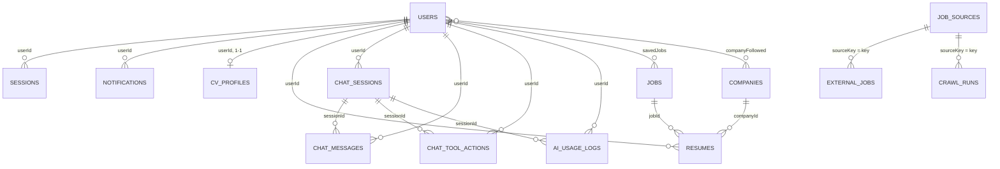
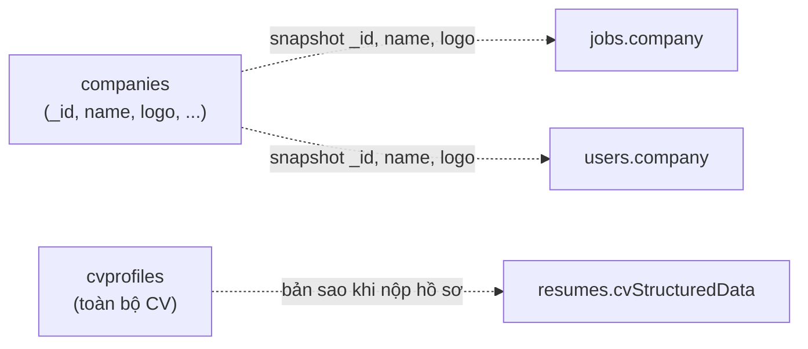

# Quan hệ giữa các collection

Tài liệu này vẽ quan hệ giữa 17 collection và phân biệt hai loại quan hệ. MongoDB **không thực thi khóa ngoại**: mọi "quan hệ" dưới đây là quy ước trong code, không phải ràng buộc của database.

| Loại | Ý nghĩa | Hệ quả |
|---|---|---|
| **Reference** | Lưu `_id` (hoặc mã chuỗi) của document ở collection khác | Xóa bản ghi gốc không tự xóa hay báo lỗi bản ghi trỏ tới nó. Code phải tự giữ nhất quán |
| **Embedded** | Sao chép dữ liệu vào trong document | Đọc nhanh, không cần nối. Dữ liệu có thể lệch so với bản gốc |

## Sơ đồ reference

Đọc sơ đồ: `USERS ||--o{ SESSIONS` nghĩa là một người dùng có nhiều phiên, và mỗi phiên thuộc đúng một người dùng. `CV_PROFILES` là quan hệ 1-1 do `unique` trên `userId` (xem [Known Limitation](collections/cv-profiles.md#known-limitation-index-userid-bị-khai-báo-hai-lần) về khả năng index này không tồn tại).

Hai tham chiếu **không** vẽ vì đích không tồn tại: `chat_sessions.legacyConversationId` và `ai_usage_logs.conversationId` trỏ tới model `Conversation` đã bỏ.

## Sơ đồ embedded

Nét đứt là sao chép dữ liệu, không phải tham chiếu. Bản sao **không tự cập nhật** khi nguồn thay đổi. Với `CompanySnapshot`, đã `grep` toàn `src/` và không thấy chỗ nào đồng bộ lại ([companies](collections/companies.md#tài-liệu-nhúng-companysnapshot)).

## Bảng chi tiết các tham chiếu

| Từ | Field | Tới | Loại | Kiểu Mongoose | Ghi chú |
|---|---|---|---|---|---|
| `sessions` | `userId` | `users` | Reference | ObjectId | `ref` khai báo |
| `notifications` | `userId` | `users` | Reference | ObjectId | `ref` khai báo |
| `cvprofiles` | `userId` | `users` | Reference | **Mixed** | Duy nhất, 1-1. Xem [kiểu ObjectId thực tế](database-overview.md#kiểu-objectid-thực-tế) |
| `resumes` | `userId` | `users` | Reference | ObjectId | Không khai báo `ref` |
| `resumes` | `companyId` | `companies` | Reference | ObjectId | `ref` khai báo |
| `resumes` | `jobId` | `jobs` | Reference | ObjectId | `ref` khai báo |
| `users` | `savedJobs[]` | `jobs` | Reference | [ObjectId] | |
| `users` | `companyFollowed[]` | `companies` | Reference | [ObjectId] | |
| `chat_sessions` | `userId` | `users` | Reference | **Mixed** | |
| `chat_messages` | `sessionId`, `userId` | `chat_sessions`, `users` | Reference | **Mixed** | |
| `chat_tool_actions` | `sessionId`, `userId` | `chat_sessions`, `users` | Reference | **Mixed** | |
| `ai_usage_logs` | `sessionId`, `userId` | `chat_sessions`, `users` | Reference | **Mixed** | |
| `chat_messages` | `relatedJobIds[]` | `jobs` | Reference logic | [String] | Mã dạng chuỗi |
| `external_jobs` | `sourceKey` | `job_sources.key` | Reference logic | String | Không phải `_id` |
| `crawl_runs` | `sourceKey` | `job_sources.key` | Reference logic | String | Không phải `_id` |
| `chat_quota_policies` | `roleName` | `ERole` | Giá trị enum | String | Không phải collection |
| `jobs`, `subscribers`, `resumes` | `skills` | `skills` | Khớp theo **tên** | [String] hoặc [Mixed] | Không có tham chiếu `_id` |

## Điều cần chú ý khi xóa dữ liệu

Vì không có ràng buộc khóa ngoại, thứ tự và phạm vi xóa do code quyết định. Ví dụ: xóa mềm `users` không tự xóa `sessions`, `resumes`, `chat_*` của người dùng đó. Cách xử lý khi xóa tài khoản nằm ở hàng đợi `account-deletion` ([account-deletion-queue.processor.ts](../../src/queues/processors/account-deletion-queue.processor.ts)); phạm vi chính xác sẽ được mô tả ở `06-workflows/use-cases/account-deletion.md` (Phase 3). Hiện `Chưa xác minh`.
