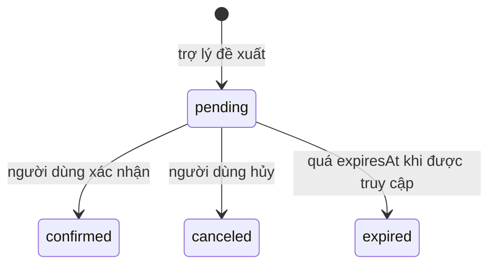

# Chat Tool Actions (`chat_tool_actions`)

Hành động mà trợ lý AI **đề xuất** và người dùng phải **xác nhận** trước khi thực hiện. Hiện chỉ có loại `save_job` (lưu một tin tuyển dụng). Cơ chế này tách quyết định của AI khỏi thay đổi dữ liệu thật.

- **Nguồn schema:** [chat-tool-action.schema.ts](../../../src/chat/schemas/chat-tool-action.schema.ts)
- **Phân loại dữ liệu:** `payload` chứa tham số hành động (mã tin tuyển dụng), không chứa nội dung hội thoại.
- **Soft-delete:** plugin thêm `isDeleted` và `deletedAt`.

## Data dictionary

| Field | Type | Required | Default | Ràng buộc | Ý nghĩa |
|---|---|---|---|---|---|
| `userId` | Mixed | Có | — | ref: `User` | Người dùng được hỏi xác nhận |
| `sessionId` | Mixed | Có | — | ref: `ChatSession` | Phiên chat phát sinh hành động |
| `type` | String | Có | — | enum: `save_job` | Loại hành động. Hiện chỉ có `save_job` |
| `status` | String | Không | `"pending"` | enum: `expired`, `canceled`, `confirmed`, `pending` | Trạng thái: `pending`, `confirmed`, `canceled`, `expired`. Mặc định `pending` |
| `payload` | Mixed | Có | — | — | Tham số hành động, dạng object tự do |
| `label` | String | Có | — | — | Nhãn hiển thị cho nút xác nhận |
| `expiresAt` | Date | Có | — | — | Hạn xác nhận |
| `confirmedAt` | Date | Không | — | — | Thời điểm xác nhận |
| `canceledAt` | Date | Không | — | — | Thời điểm hủy |
| `createdAt` | Date | Không | — | — | Thời điểm tạo |
| `updatedAt` | Date | Không | — | — | Thời điểm sửa gần nhất |
| `isDeleted` | Boolean | Có | `false` | thêm bởi plugin xóa mềm | Cờ xóa mềm. `true` nghĩa là bản ghi đã bị xóa khỏi nghiệp vụ nhưng vẫn còn trong database |
| `deletedAt` | Date | Không | `null` | thêm bởi plugin xóa mềm | Thời điểm xóa mềm |

## Indexes

| Keys | Thuộc tính | Mục đích |
|---|---|---|
| `{ type: 1 }` | — | Lọc theo loại |
| `{ status: 1 }` | — | Lọc theo trạng thái |
| `{ expiresAt: 1 }` | — | Lọc theo hạn. Index thường, không phải TTL |
| `{ userId: 1, status: 1, expiresAt: 1 }` | — | Tìm hành động còn chờ của một người |
| `{ sessionId: 1, status: 1, createdAt: -1 }` | — | Hành động của một phiên theo trạng thái, mới nhất trước |

`expiresAt` có index thường (`index: true`), **không phải TTL**. Bản ghi hết hạn không tự bị xóa.

## Vòng đời



- `expiresAt` = thời điểm tạo + `CHAT_TOOL_ACTION_EXPIRY_MS`, mặc định 15 phút ([chat.constant.ts](../../../src/chat/constants/chat.constant.ts), đọc được từ cấu hình).
- Việc chuyển `expired` xảy ra **khi action được truy cập sau hạn**, không do tác vụ nền ([chat-tool-action.service.ts](../../../src/chat/chat-tool-action.service.ts)). Action không ai chạm tới sẽ ở `pending` mãi mãi dù đã quá hạn.

## Quan hệ

| Field | Loại | Đích |
|---|---|---|
| `userId` | Reference, `ref: 'User'` | `users`. Mixed, xem [database-overview](../database-overview.md#kiểu-objectid-thực-tế) |
| `sessionId` | Reference, `ref: 'ChatSession'` | `chat_sessions`. Mixed |

## Ví dụ document

```json
{
  "_id": "665f1a2b3c4d5e6f70819f51",
  "userId": "665f1a2b3c4d5e6f70819201",
  "sessionId": "665f1a2b3c4d5e6f70819e01",
  "type": "save_job",
  "status": "pending",
  "label": "Luu tin: Senior Backend Engineer",
  "payload": { "jobId": "665f1a2b3c4d5e6f70819301" },
  "expiresAt": "2026-10-03T03:15:00.000Z",
  "isDeleted": false
}
```

Cấu trúc `payload` trong ví dụ là minh họa: schema khai báo `Record<string, unknown>`. Tên khóa thật của `save_job` nằm trong `chat-tool-action.service.ts`.

## Lưu ý

- **Known Limitation:** bản ghi `pending` quá hạn không tự đổi sang `expired` (xem trên). Truy vấn danh sách "đang chờ" phải tự lọc theo `expiresAt`.
