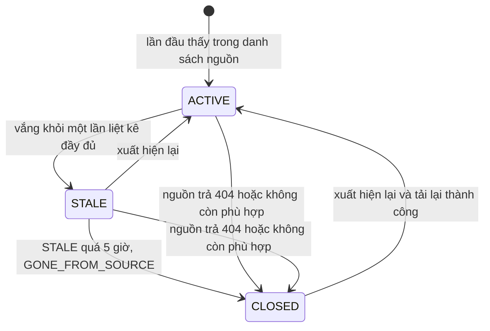

# External Jobs (`external_jobs`)

Tin tuyển dụng được đồng bộ từ nguồn bên ngoài (ATS của công ty hoặc trang việc làm). Khác với [jobs](jobs.md), tin ở đây không do người dùng DevLink đăng và không qua duyệt; quyền hiển thị được quyết định bởi `displayPolicy` của [job-sources](job-sources.md).

- **Nguồn schema:** [external-job.schema.ts](../../../src/job-ingestion/schemas/external-job.schema.ts)
- **Phân loại dữ liệu:** nội dung tin tuyển dụng công khai của bên thứ ba, không có dữ liệu cá nhân của người dùng DevLink.
- **Soft-delete:** schema không khai báo, nhưng plugin thêm `isDeleted` và `deletedAt`. Vòng đời tin dùng `status` (`ACTIVE`, `STALE`, `CLOSED`), không dùng xóa mềm.

## Data dictionary

| Field | Type | Required | Default | Ràng buộc | Ý nghĩa |
|---|---|---|---|---|---|
| `sourceKey` | String | Có | — | — | Khóa của nguồn tin (`job_sources.key`) |
| `externalId` | String | Có | — | — | Mã tin tại hệ thống nguồn |
| `sourceUrl` | String | Có | — | — | Địa chỉ trang tin gốc |
| `applyUrl` | String | Không | — | — | Địa chỉ nộp hồ sơ tại nguồn |
| `title` | String | Có | — | trim | Tên vị trí |
| `companyName` | String | Có | — | trim | Tên công ty đăng tin tại nguồn |
| `location` | String | Có | — | trim | Tên địa điểm |
| `locationCode` | String | Không | — | lowercase; trim | Mã địa điểm đã chuẩn hóa, chữ thường |
| `isRemote` | Boolean | Có | `false` | — | Cho phép làm từ xa |
| `skills` | [String] | Không | `[]` | — | Danh sách kỹ năng đã chuẩn hóa |
| `level` | String | Không | — | enum: `Manager`, `Lead`, `Senior`, `Mid`, `Junior`, `Internship` | Cấp bậc, cùng bộ giá trị với `jobs.level` |
| `descriptionHtml` | String | Có | `""` | — | Mô tả dạng HTML. Rỗng nếu nguồn có chính sách `LINK_ONLY` |
| `publishedAt` | Date | Không | — | — | Ngày đăng tại nguồn |
| `expiresAt` | Date | Không | — | — | Ngày hết hạn tại nguồn |
| `salaryText` | String | Không | — | trim | Mức lương dạng văn bản gốc từ nguồn |
| `status` | String | Có | `"ACTIVE"` | enum: `CLOSED`, `STALE`, `ACTIVE` | Trạng thái vòng đời: `ACTIVE`, `STALE`, `CLOSED` |
| `lastSeenAt` | Date | Có | — | — | Lần gần nhất tin xuất hiện trong danh sách nguồn |
| `lastFetchedAt` | Date | Không | — | — | Lần gần nhất tải chi tiết tin |
| `lastContentUpdatedAt` | Date | Không | — | — | Lần gần nhất nội dung thay đổi |
| `contentHash` | String | Không | — | — | SHA-1 của 13 field nội dung, dùng để phát hiện thay đổi |
| `staleSince` | Date | Không | — | — | Thời điểm chuyển sang `STALE`. Dùng để tính thời gian ân hạn |
| `closedAt` | Date | Không | — | — | Thời điểm đóng tin |
| `closeReason` | String | Không | — | enum: `NO_LONGER_MATCHES`, `EXPIRED`, `NOT_FOUND`, `GONE_FROM_SOURCE` | Lý do đóng tin |
| `createdAt` | Date | Không | — | — | Thời điểm tạo, do `timestamps` hoặc plugin |
| `updatedAt` | Date | Không | — | — | Thời điểm sửa gần nhất, do `timestamps` |
| `isDeleted` | Boolean | Có | `false` | thêm bởi plugin xóa mềm | Cờ xóa mềm. `true` nghĩa là bản ghi đã bị xóa khỏi nghiệp vụ nhưng vẫn còn trong database |
| `deletedAt` | Date | Không | `null` | thêm bởi plugin xóa mềm | Thời điểm xóa mềm |

## Indexes

| Keys | Thuộc tính | Mục đích |
|---|---|---|
| `{ sourceKey: 1, externalId: 1 }` | unique | Khóa tự nhiên, đảm bảo không trùng tin trong cùng nguồn |
| `{ status: 1, publishedAt: -1 }` | — | Liệt kê tin hiển thị, mới đăng trước |
| `{ locationCode: 1, status: 1 }` | — | Lọc theo địa điểm và trạng thái |
| `{ skills: 1 }` | — | Lọc theo kỹ năng |
| `{ sourceKey: 1, status: 1, lastFetchedAt: 1 }` | — | Chọn tin cần tải lại của một nguồn |

Cặp `{ sourceKey, externalId }` là khóa tự nhiên: cùng một tin từ cùng một nguồn không bao giờ có hai bản ghi, nên đồng bộ lặp lại là cập nhật chứ không nhân bản.

## Quan hệ

| Field | Loại | Đích |
|---|---|---|
| `sourceKey` | Tham chiếu logic bằng chuỗi | `job_sources.key`. Không phải ObjectId, MongoDB không ràng buộc |
| `skills` | Chuỗi tên | Đã được chuẩn hóa qua `aliasMap` từ danh mục [skills](skills.md) khi nạp |

## Vòng đời



Các quy tắc do [job-lifecycle.service.ts](../../../src/job-ingestion/job-lifecycle.service.ts) quyết định (hàm thuần, có test riêng), hằng số ở [job-ingestion.constants.ts](../../../src/job-ingestion/job-ingestion.constants.ts):

| Quy tắc | Giá trị | Ý nghĩa |
|---|---|---|
| `STALE_GRACE_HOURS` | 5 giờ | Tin `STALE` còn hiển thị trong thời gian ân hạn này, sau đó mới đóng. Comment trong code: hơi ngắn hơn chu kỳ cron 6 giờ để lần chạy kế tiếp chắc chắn đóng được |
| `REFRESH_AFTER_DAYS` | 7 ngày | Tin hoạt động được tải lại chi tiết sau 7 ngày |
| `MIN_LISTED_RATIO` và `MIN_BASELINE_FOR_RATIO` | 0.5 và 20 | Nếu danh sách nguồn co lại dưới 50% so với mức nền (và mức nền ≥ 20) thì coi là đáng ngờ (`SUSPECT`), **không đóng tin nào vì vắng mặt** |
| Danh sách rỗng | — | Rỗng khi mức nền > 0 cũng bị coi là đáng ngờ |
| `VISIBLE_EXTERNAL_JOB_STATUSES` | `ACTIVE`, `STALE` | Chỉ hai trạng thái này được tìm kiếm trả về |

`closeReason`:

| Giá trị | Khi nào |
|---|---|
| `GONE_FROM_SOURCE` | `STALE` quá thời gian ân hạn mà vẫn vắng khỏi danh sách đầy đủ |
| `NOT_FOUND` | Tải chi tiết bị từ chối với lý do `NOT_FOUND` |
| `NO_LONGER_MATCHES` | Tải lại thấy tin không còn là tin IT hoặc thiếu trường bắt buộc |
| `EXPIRED` | Tin có `expiresAt` đã qua |

`EXPIRED` do `closeExpired` gán cho tin ACTIVE hoặc STALE có `expiresAt` đã qua ([external-job.repository.ts](../../../src/job-ingestion/external-job.repository.ts)). `NO_LONGER_MATCHES` đến từ tin bị loại khi tải lại vì lý do khác `NOT_FOUND` (xem `computeTransitions`). Quy trình đầy đủ ở [job-ingestion](../../03-modules/job-ingestion.md).

## Ví dụ document

```json
{
  "_id": "665f1a2b3c4d5e6f70819b01",
  "sourceKey": "greenhouse-example",
  "externalId": "4012345",
  "sourceUrl": "https://boards.example.com/example/jobs/4012345",
  "applyUrl": "https://boards.example.com/example/jobs/4012345#apply",
  "title": "Backend Engineer",
  "companyName": "Example Software Co.",
  "location": "Ho Chi Minh",
  "locationCode": "ho-chi-minh",
  "isRemote": false,
  "skills": ["Node.js", "MongoDB"],
  "level": "Senior",
  "descriptionHtml": "",
  "publishedAt": "2026-10-01T00:00:00.000Z",
  "salaryText": "Negotiable",
  "status": "ACTIVE",
  "lastSeenAt": "2026-10-05T06:00:00.000Z",
  "lastFetchedAt": "2026-10-05T06:00:00.000Z",
  "contentHash": "<sha1-hex>",
  "isDeleted": false
}
```

`descriptionHtml` rỗng trong ví dụ vì nguồn có `displayPolicy = LINK_ONLY`: mô tả không được lưu (`keepDescription: false` trong [normalized-external-job.interface.ts](../../../src/job-ingestion/interfaces/normalized-external-job.interface.ts)).

## Lưu ý

- `contentHash` là SHA-1 của mảng 13 field theo thứ tự cố định: `title`, `companyName`, `location`, `locationCode`, `isRemote`, `skills`, `level`, `descriptionHtml`, `publishedAt`, `expiresAt`, `salaryText`, `applyUrl`, `sourceUrl` ([ingestion-filters.ts](../../../src/job-ingestion/ingestion-filters.ts)). Nếu băm không đổi, đồng bộ chỉ cập nhật `status`, `lastFetchedAt`, `lastSeenAt`, không ghi lại nội dung và không đổi `lastContentUpdatedAt`. Với nguồn `LINK_ONLY`, `descriptionHtml` luôn rỗng nên thay đổi mô tả ở nguồn không làm đổi băm.
- **Known Limitation:** `sourceKey` là chuỗi, nên đổi `key` của một nguồn sẽ làm tin cũ mất liên kết. Chưa kiểm tra có chặn đổi `key` không.
- **Migration:** thêm nguồn mới không cần migration. Muốn xóa hẳn tin của một nguồn phải xóa theo `sourceKey`.
