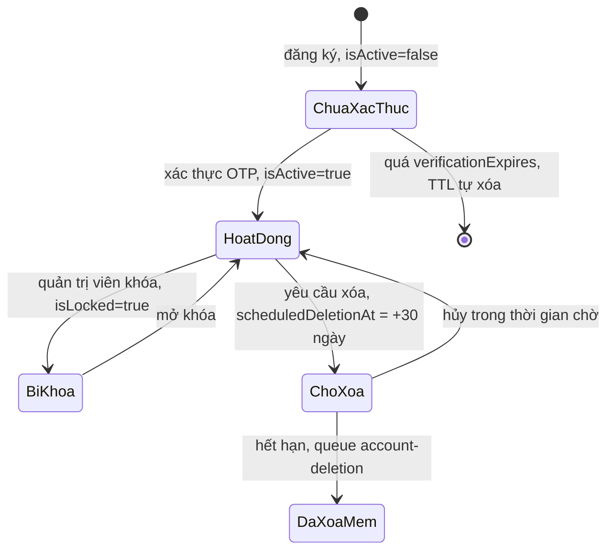

# Users (`users`)

Lưu tài khoản của cả ba vai trò (`NORMAL USER`, `HR`, `SUPER ADMIN`). Đây là collection trung tâm: hầu hết collection khác tham chiếu tới `_id` của nó.

- **Nguồn schema:** [user.schema.ts](../../../src/users/schemas/user.schema.ts)
- **Phân loại dữ liệu:** có dữ liệu cá nhân (tên, email, ảnh đại diện) và thông tin xác thực (mật khẩu đã băm, `googleId`).
- **Soft-delete:** có. Xem [xóa mềm](../database-overview.md#xóa-mềm).

## Data dictionary

| Field | Type | Required | Default | Ràng buộc | Ý nghĩa |
|---|---|---|---|---|---|
| `name` | String | Có | — | trim | Tên hiển thị của người dùng |
| `email` | String | Có | — | lowercase; trim | Email đăng nhập, luôn chữ thường. Duy nhất giữa các tài khoản chưa xóa mềm |
| `password` | String | Không | — | — | Mật khẩu đã băm bằng bcryptjs (salt 10). Trống với tài khoản Google |
| `authProvider` | String | Không | `"local"` | enum: `google`, `local` | Cách đăng ký: `local` (email và mật khẩu) hoặc `google` |
| `googleId` | String | Không | — | unique; sparse | Mã người dùng của Google, chỉ có khi đăng nhập Google |
| `avatar` | String | Không | — | trim | Đường dẫn ảnh đại diện |
| `isActive` | Boolean | Không | `false` | — | `true` sau khi xác thực OTP. Tài khoản `false` chưa xác thực và có thể bị TTL xóa |
| `isLocked` | Boolean | Không | `false` | — | Quản trị viên đã khóa tài khoản |
| `lockReason` | String | Không | — | — | Lý do khóa |
| `lockedBy` | Mixed | Không | — | — | Người khóa, dạng `{ _id, email }` |
| `lockedAt` | Date | Không | — | — | Thời điểm khóa |
| `codeExpired` | Date | Không | — | — | Hạn mã xác thực cũ. Không còn được dùng (xem Lưu ý) |
| `verificationExpires` | Date | Không | — | — | Hạn xác thực tài khoản mới. TTL index xóa tài khoản chưa xác thực khi quá hạn |
| `company` | Subdoc | Không | — | — | Snapshot công ty của HR. Embedded, không phải tham chiếu |
| `company._id` | ObjectId | Có | — | — | `_id` của công ty trong collection `companies` |
| `company.name` | String | Có | — | trim | Tên công ty tại thời điểm lưu snapshot |
| `company.logo` | String | Không | `null` | trim | Đường dẫn logo tại thời điểm lưu snapshot |
| `role` | String | Có | — | enum: `SUPER ADMIN`, `HR`, `NORMAL USER` | Vai trò: `SUPER ADMIN`, `HR` hoặc `NORMAL USER` |
| `savedJobs` | [ObjectId] | Không | `[]` | ref: `Job` | Danh sách tin tuyển dụng đã lưu |
| `companyFollowed` | [ObjectId] | Không | `[]` | ref: `Company` | Danh sách công ty đang theo dõi |
| `createdBy` | Mixed | Không | — | — | Người tạo bản ghi, dạng `{ _id, email }` |
| `updatedBy` | Mixed | Không | — | — | Người sửa gần nhất, dạng `{ _id, email }` |
| `deletedBy` | Mixed | Không | — | — | Người xóa mềm, dạng `{ _id, email }` |
| `createdAt` | Date | Không | — | — | Thời điểm tạo, do `timestamps` |
| `updatedAt` | Date | Không | — | — | Thời điểm sửa gần nhất, do `timestamps` |
| `scheduledDeletionAt` | Date | Không | — | — | Thời điểm tài khoản sẽ bị xóa sau khi người dùng yêu cầu. Trống nếu không có yêu cầu |
| `isDeleted` | Boolean | Không | — | — | Cờ xóa mềm. `true` nghĩa là tài khoản đã bị xóa khỏi hệ thống nhưng giữ lại bản ghi để truy vết |
| `deletedAt` | Date | Không | — | — | Thời điểm xóa mềm |

Các field `createdBy`, `updatedBy`, `deletedBy`, `lockedBy` khai báo `type: Object` nên là Mixed: Mongoose không kiểm tra cấu trúc. Theo quy ước trong code, giá trị là `{ _id, email }` của người thực hiện.

## Indexes

| Keys | Thuộc tính | Mục đích |
|---|---|---|
| `{ googleId: 1 }` | unique, sparse | Tra cứu đăng nhập Google. Unique và sparse nên chỉ áp dụng cho tài khoản có `googleId` |
| `{ role: 1 }` | — | Lọc người dùng theo vai trò |
| `{ email: 1 }` | unique, partial `{"isDeleted":false}` | Đảm bảo email duy nhất giữa các tài khoản chưa xóa mềm |
| `{ email: 1, isDeleted: 1 }` | — | Tra cứu theo email kèm điều kiện xóa mềm |
| `{ companyFollowed: 1 }` | — | Tìm người theo dõi một công ty |
| `{ savedJobs: 1 }` | — | Tìm người đã lưu một tin |
| `{ googleId: 1, isDeleted: 1 }` | sparse | Tra cứu Google kèm điều kiện xóa mềm |
| `{ verificationExpires: 1 }` | TTL 0s, partial `{"isActive":false}` | TTL tự xóa tài khoản chưa xác thực |

Index `{ email: 1 }` kết hợp `partialFilterExpression: { isDeleted: false }` cho phép đăng ký lại bằng email của một tài khoản đã xóa mềm, nhưng không cho hai tài khoản chưa xóa dùng cùng email.

## Quan hệ

| Field | Loại | Đích |
|---|---|---|
| `company` | Embedded (`CompanySnapshot`) | Bản sao `_id`, `name`, `logo` của công ty mà HR thuộc về. Không tự cập nhật khi `companies` đổi |
| `savedJobs` | Reference (mảng ObjectId) | `jobs` |
| `companyFollowed` | Reference (mảng ObjectId) | `companies` |

MongoDB không ràng buộc các tham chiếu này. Code chịu trách nhiệm giữ nhất quán.

## Ví dụ document

Dữ liệu giả, giá trị `password` là chuỗi băm minh họa.

```json
{
  "_id": "665f1a2b3c4d5e6f70819201",
  "name": "Nguyen Van A",
  "email": "candidate@example.com",
  "password": "$2a$10$<bcrypt-hash>",
  "authProvider": "local",
  "isActive": true,
  "isLocked": false,
  "role": "NORMAL USER",
  "savedJobs": ["665f1a2b3c4d5e6f70819301"],
  "companyFollowed": [],
  "scheduledDeletionAt": null,
  "isDeleted": false,
  "deletedAt": null,
  "createdAt": "2026-10-01T03:00:00.000Z",
  "updatedAt": "2026-10-01T03:05:00.000Z"
}
```

## Vòng đời



- **Tạo tài khoản:** `verificationExpires` được đặt 15 phút sau thời điểm đăng ký ([users.service.ts](../../../src/users/users.service.ts)). TTL index chỉ áp dụng cho tài khoản có `isActive: false`, nên tài khoản đã xác thực không bị xóa.
- **Xóa tài khoản:** đặt `scheduledDeletionAt` sau 30 ngày chờ ([auth-account-deletion.service.ts](../../../src/auth/services/auth-account-deletion.service.ts)). Việc xóa thật do hàng đợi `account-deletion` thực hiện bằng xóa mềm.

## Lưu ý

- **Known Limitation:** `codeExpired` có trong schema nhưng không được dùng ở logic nghiệp vụ nào. Chỉ xuất hiện trong projection của [account-deletion-queue.processor.ts](../../../src/queues/processors/account-deletion-queue.processor.ts). Có vẻ là phần còn lại của luồng OTP cũ. Chưa kiểm tra lịch sử git.
- **Known Limitation:** `company` là snapshot, không tự đồng bộ khi công ty đổi tên hay logo. Xem [companies](companies.md).
- **Migration:** thêm field mới không cần migration vì Mongoose trả `undefined` cho field thiếu. Thêm unique index lên collection đã có dữ liệu trùng sẽ thất bại.
