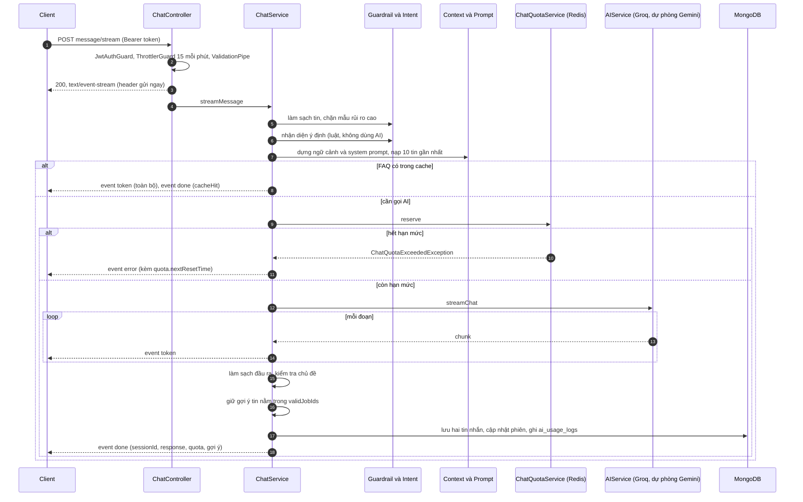

# Sequence: chat AI dạng stream

Trình tự của `POST /api/v1/chat/message/stream` (và biến thể theo phiên). Quy tắc và guardrail: [ai-chat](../../03-modules/ai-chat.md). Định dạng sự kiện: [realtime](../../05-api/realtime.md#stream-chat-ai).

## Actor

Người dùng đã đăng nhập; không có khách.

## Luồng chính

## Nhánh lỗi

| Tình huống | Khi nào | Biểu hiện với client |
|---|---|---|
| Thiếu hoặc sai token, DTO sai, vượt 15 lượt mỗi phút | Trước `flushHeaders` | HTTP `401`, `400`, `429` thường, không phải SSE |
| Tin nhắn bị guardrail chặn (rủi ro cao) | Trong `prepareChatTurn`, **sau** khi header `200` đã gửi | Sự kiện `error` với thông điệp "Your message appears to contain instructions that cannot be processed by the chatbot." |
| Hết hạn mức ngày | Ở `reserve` | Sự kiện `error` kèm `quota.remainingQuota` và `quota.nextResetTime` |
| Nhà cung cấp chính lỗi đủ điều kiện (giới hạn tốc độ, 5xx, hết thời gian) | Khi gọi AI | Chuyển sang Gemini nếu bật dự phòng và còn quota `chat-fallback` |
| Lỗi trước khi có `token` nào | Khi gọi AI | Hoàn quota (`rollback`), sự kiện `error` |
| Lỗi không phải `HttpException` | Bất kỳ | Sự kiện `error` với thông điệp chung, không lộ chi tiết |
| Bộ lọc chủ đề phát hiện lạc đề | Sau khi sinh | Thay nội dung bằng thông báo từ chối song ngữ |
| Bộ lọc chủ đề lỗi | Sau khi sinh | Cho qua (fail-open) |

Vì header `200` được gửi trước khi xử lý, mọi lỗi sau đó đến qua sự kiện `error` chứ không qua mã HTTP. Điểm guardrail trả `400` ở route JSON nhưng thành sự kiện `error` ở route stream là suy ra từ việc `prepareChatTurn` nằm trong generator; chưa chạy thử để xác nhận.

## Ghi chú

- Đường stream không dùng AI để phân loại ý định (`allowAiIntentClassifier: false`), tiết kiệm một lần gọi.
- Cache FAQ không tiêu hạn mức.
- Lưu hội thoại và ghi nhật ký diễn ra sau khi sinh xong, trước sự kiện `done`.
