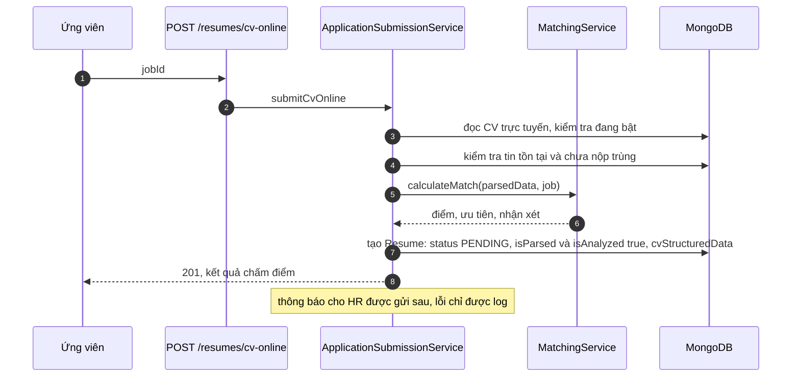
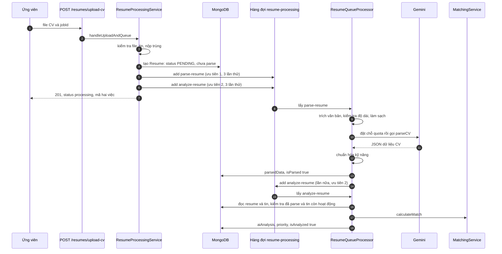

# Sequence: nộp hồ sơ và xử lý CV

Hai đường nộp hồ sơ có trình tự khác nhau. Quy tắc chấm điểm: [cv-parsing-and-matching](../../03-modules/cv-parsing-and-matching.md). Quy tắc nghiệp vụ hồ sơ: [resumes](../../03-modules/resumes.md).

## Actor

| Actor | Vai trò |
|---|---|
| Ứng viên | Nộp hồ sơ |
| API | `ResumesController` và các service |
| Hàng đợi `resume-processing` | Chạy việc đọc và phân tích, tối đa 15 việc mỗi 60 giây, một worker |
| Gemini | Trích xuất dữ liệu CV |
| Nhà tuyển dụng | Nhận thông báo, xử lý hồ sơ |

## Đường 1: CV trực tuyến (đồng bộ)

Không dùng AI và không đi qua hàng đợi: dữ liệu CV đã có cấu trúc sẵn.

## Đường 2: tải file CV (bất đồng bộ)

## Nhánh thay thế và lỗi

| Tình huống | Xử lý |
|---|---|
| Văn bản CV dưới 100 ký tự, trên 50.000, hoặc dưới 50 từ | Ném lỗi `Invalid CV text`, ghi `parseError`, retry theo cấu hình |
| Hết quota Gemini (phút hoặc ngày) | Không tính là lỗi: lên lịch lại `parse-resume` với độ trễ và nhiễu ngẫu nhiên, việc hiện tại hoàn tất với `delayed: true` |
| Gemini trả lỗi giới hạn tốc độ | Retry với backoff mũ bên trong `GeminiService` |
| Lỗi khác khi đọc | Ghi `parseError`, `isParsed = false`, ném lại để BullMQ retry (3 lần, backoff mũ từ 2 giây) |
| Việc `analyze` chạy khi chưa parse xong | Ném `Resume must be parsed before analysis`, ghi `analysisError`, retry |
| Tin đã hết hoạt động khi phân tích | Ném `Job is no longer active`, ghi `analysisError` |
| Đã có kết quả parse trong cache | Trả ngay từ cache, bỏ qua bước trích xuất (cache nằm trong bộ nhớ tiến trình) |
| Quản trị viên hoặc HR gọi `reparse` hoặc `reanalyze` | Đưa lại việc tương ứng vào hàng đợi |

## Ghi chú

- Việc `analyze` được đưa vào hàng đợi **hai lần** trong đường 2: một lần lúc nộp, một lần sau khi parse xong. Hàng đợi không đặt `jobId` cố định cho hai loại việc này nên không loại trùng; xem [queues](../../03-modules/queues.md#known-limitation).
- Ưu tiên 1 (parse) được xử lý trước ưu tiên 2 (analyze) trong BullMQ, nhờ vậy `analyze` được đưa lúc nộp thường chạy sau `parse`.
- Phản hồi dự kiến "30-60 seconds" là chuỗi cố định trong code, không phải số đo.
- Văn bản CV được gửi tới Gemini và có thể xuất hiện trong log, xem [known limitation](../../03-modules/cv-parsing-and-matching.md#known-limitation).
