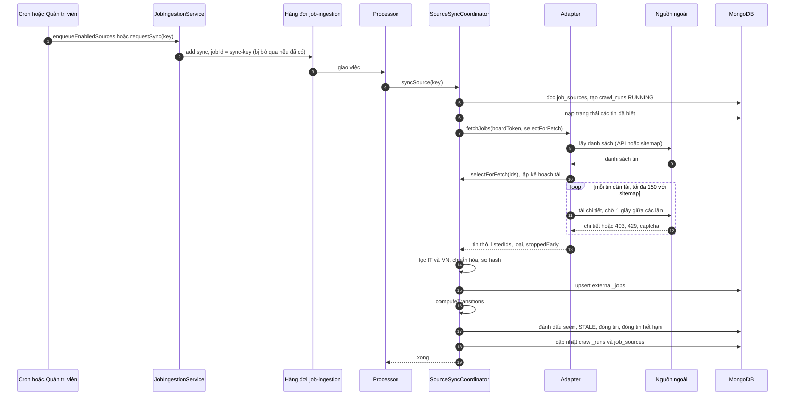

# Sequence: đồng bộ tin từ nguồn ngoài

Trình tự tương tác khi đồng bộ một nguồn. Giải thích thiết kế và quy tắc nằm ở [job-ingestion](../../03-modules/job-ingestion.md); tài liệu này chỉ vẽ thứ tự.

## Actor

| Actor | Vai trò |
|---|---|
| Cron | Kích hoạt mỗi 6 giờ cho nguồn đang bật |
| Quản trị viên | Kích hoạt tay một nguồn bằng `POST /job-sources/:key/sync` |
| Processor | Worker BullMQ chạy `syncSource` |
| Nguồn ngoài | ATS hoặc trang việc làm |

## Luồng chính

## Nhánh thay thế và lỗi

| Tình huống | Điểm xảy ra | Kết quả |
|---|---|---|
| Nguồn bị tắt hoặc không tồn tại | Bước đầu của `run` | Ghi cảnh báo, bỏ qua, không tạo `crawl_runs` |
| Việc cùng `jobId` đã có | `add` ở bước 2 | BullMQ bỏ qua, không tạo việc thứ hai |
| Bị chặn 403, 429, captcha | Vòng tải chi tiết | Dừng vòng lặp, `stoppedEarly`, kết quả `PARTIAL`, vẫn áp dụng bước vòng đời với danh sách đầy đủ |
| Danh sách rỗng hoặc co dưới 50% mức nền | `isSuspectListing` | `SUSPECT`, `computeTransitions` không đóng tin vì vắng mặt |
| Lỗi không bắt được | Bất kỳ bước | `crawl_runs` thành `FAILED`, ném lại, BullMQ retry tối đa 3 lần với backoff mũ bắt đầu 5 giây |
| Không có adapter cho provider | Đầu `sync` | `UnrecoverableError`, không retry |

## Thành phần liên quan

- Hàng đợi và retry: `03-modules/queues.md` (sẽ có ở cùng Phase).
- Dữ liệu: [external-jobs](../../04-database/collections/external-jobs.md), [crawl-runs](../../04-database/collections/crawl-runs.md).
