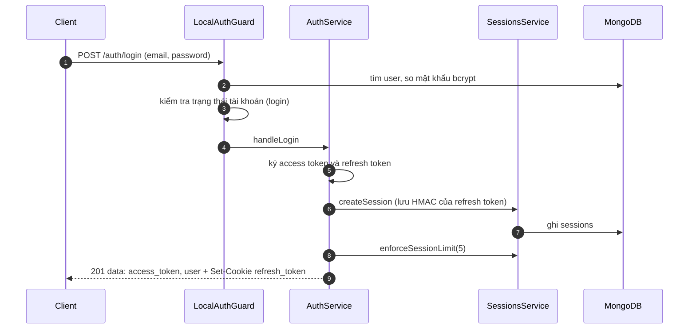
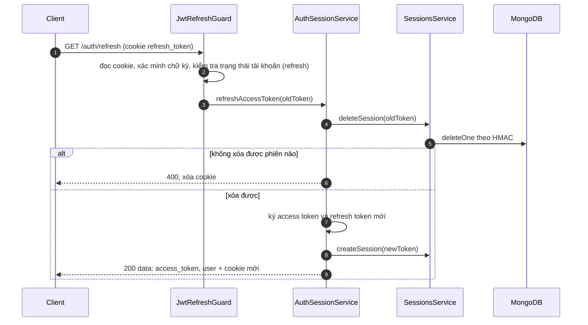

# Sequence: đăng nhập và làm mới token

Quy tắc token, cookie và phiên: [auth-and-sessions](../../03-modules/auth-and-sessions.md). Route: [auth endpoints](../../05-api/endpoints/auth.md).

## Đăng nhập

## Làm mới token

## Quyết định thiết kế quan sát được

- **Xoay vòng một lần dùng:** refresh token cũ bị xóa ngay; dùng lại sẽ không tìm thấy phiên và nhận `400` ("Session not found or already used").
- Refresh token chỉ tồn tại trong cookie `httpOnly` (JavaScript phía trình duyệt không đọc được); access token nằm trong body.
- Trạng thái tài khoản được kiểm tra lại ở mỗi lần làm mới, nên tài khoản bị khóa không làm mới được.

## Known Limitation

| Vấn đề | Chi tiết |
|---|---|
| Không có giao dịch | Xóa phiên cũ rồi mới tạo phiên mới; nếu bước tạo lỗi, người dùng mất phiên và phải đăng nhập lại |
| Hai lần làm mới đồng thời | Lần thứ hai thấy phiên đã bị xóa, nhận `400` và bị xóa cookie. Ứng dụng nhiều tab cần tự điều phối việc gọi làm mới |
| Không phát hiện tái sử dụng | Dùng lại token cũ chỉ báo lỗi, không thu hồi các phiên khác của người dùng |
| Mọi lỗi gộp thành một thông điệp | Mọi ngoại lệ trong khối `try` trả `400` "Refresh token không hợp lệ" kèm thông điệp lỗi gốc, lẫn lộn lỗi hạ tầng với token sai |
| Index trùng trên `sessions` | TTL và unique của phiên có thể không tồn tại, xem [sessions](../../04-database/collections/sessions.md#known-limitation-index-trùng-key-pattern) |
