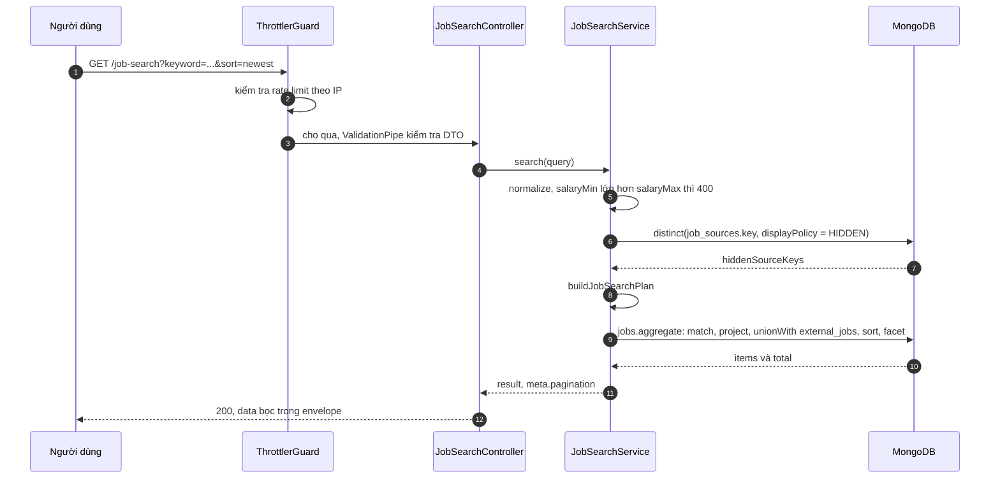
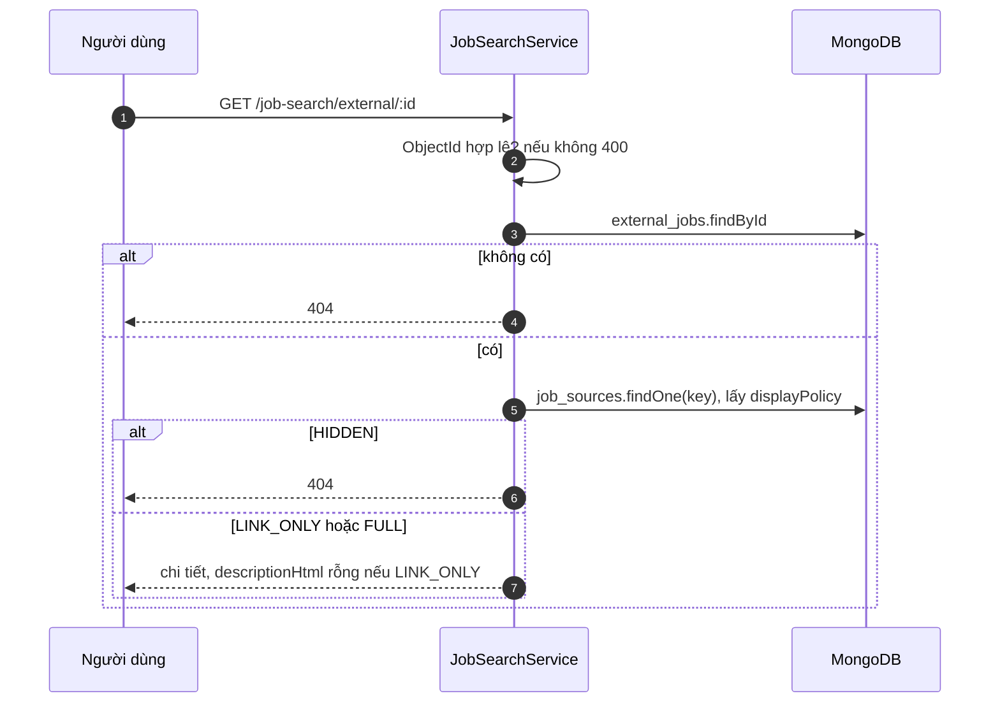

# Sequence: tìm kiếm hợp nhất tin nội bộ và tin ngoài

Trình tự của `GET /api/v1/job-search`. Quy tắc lọc, sắp xếp và giới hạn: [job-search](../../03-modules/job-search.md).

## Actor

Khách hoặc người dùng đã đăng nhập (route công khai). Không yêu cầu token.

## Luồng chính (`source=all`, không có lọc loại trừ tin ngoài)

## Các nhánh

| Tình huống | Điểm rẽ | Kết quả |
|---|---|---|
| `source=internal` | `buildJobSearchPlan` | Pipeline chỉ chạy trên `jobs`, bỏ truy vấn `hiddenSourceKeys` |
| `source=external` | `buildJobSearchPlan` | Pipeline chạy trên `external_jobs` |
| Có `salaryMin` hoặc `salaryMax`, hoặc `formOfWork` khác `Remote` | Dựng stage ngoài trả `null` | Phía ngoài bị bỏ. Với `source=all` chỉ còn tin nội bộ. Với `source=external` trả danh sách rỗng mà không chạy aggregation (truy vấn `distinct` ẩn nguồn vẫn chạy trước đó) |
| Vượt rate limit | `ThrottlerGuard` | `429` |
| Tham số sai | `ValidationPipe` | `400` |
| `salaryMin` lớn hơn `salaryMax` | `normalize` | `400` |

## Chi tiết một tin ngoài

## Ghi chú

- Mỗi request chạy một aggregation và một truy vấn `distinct`; không có cache ([job-search](../../03-modules/job-search.md#known-limitation)).
- Phản hồi dùng envelope chung `{ statusCode, message, data }` vì route không có `@SkipTransform`.
