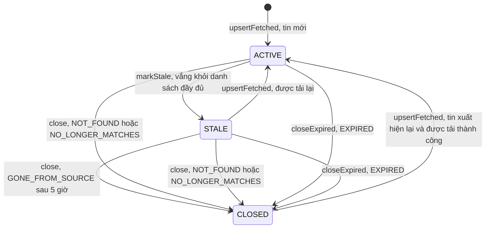

# State machine: vòng đời tin ngoài (`external_jobs.status`)

Mô tả các trạng thái và chuyển trạng thái của một tin lấy từ nguồn ngoài. Chỉ vẽ chuyển trạng thái **có trong code**; mỗi mũi tên ghi nơi thực hiện.

## Trạng thái

| Trạng thái | Ý nghĩa | Hiển thị công khai |
|---|---|---|
| `ACTIVE` | Vừa được thấy hoặc tải gần đây | Có |
| `STALE` | Vắng khỏi một danh sách đầy đủ, đang trong thời gian ân hạn | Có (trả ra dưới dạng `ACTIVE`) |
| `CLOSED` | Đã đóng, kèm `closeReason` | Không trong danh sách tìm kiếm; chi tiết trả `status: CLOSED` |

`VISIBLE_EXTERNAL_JOB_STATUSES` là `ACTIVE` và `STALE` ([job-ingestion.constants.ts](../../../src/job-ingestion/job-ingestion.constants.ts)).

## Sơ đồ

## Bảng chuyển trạng thái

| Từ | Đến | Điều kiện | Nơi thực hiện |
|---|---|---|---|
| (chưa có) | `ACTIVE` | Lần đầu tải thành công và qua bộ lọc | `upsertFetched` ([external-job.repository.ts](../../../src/job-ingestion/external-job.repository.ts)) |
| `ACTIVE` | `STALE` | Không được tải lần này, không bị loại, **không nằm** trong danh sách, và danh sách đầy đủ (`listingComplete`) | `computeTransitions` rồi `markStale` |
| `STALE` | `ACTIVE` | Được tải lại thành công | `upsertFetched` (xóa `staleSince`, `closedAt`, `closeReason`) |
| `STALE` | `CLOSED` | `staleSince` quá 5 giờ (`STALE_GRACE_HOURS`) mà vẫn vắng, danh sách đầy đủ | `computeTransitions`: `GONE_FROM_SOURCE` |
| `ACTIVE` hoặc `STALE` | `CLOSED` | Tải lại bị loại với lý do `NOT_FOUND` | `computeTransitions`: `NOT_FOUND` |
| `ACTIVE` hoặc `STALE` | `CLOSED` | Tải lại bị loại với lý do khác (không còn là tin IT, thiếu trường) | `computeTransitions`: `NO_LONGER_MATCHES` |
| `ACTIVE` hoặc `STALE` | `CLOSED` | `expiresAt` đã qua | `closeExpired`: `EXPIRED` |
| `CLOSED` | `ACTIVE` | Tin xuất hiện lại trong danh sách và được tải thành công (tính vào `reactivated`) | `upsertFetched` |

Tin đã `CLOSED` và có `closeReason = EXPIRED` còn **mới** (tải trong vòng 7 ngày) không bị tải lại vì nguồn thường giữ tin hết hạn trong danh sách một thời gian ([job-lifecycle.service.ts](../../../src/job-ingestion/job-lifecycle.service.ts), `planFetch`).

## Điều kiện bảo vệ

Chuyển sang `STALE` hoặc đóng vì vắng mặt **bị chặn** khi lần đồng bộ là `SUSPECT` (`listingComplete = !suspect` trong [source-sync-coordinator.ts](../../../src/job-ingestion/source-sync-coordinator.ts)). Lần `PARTIAL` (dừng sớm khi tải chi tiết) vẫn áp dụng vì danh sách đã đầy đủ; lần `FAILED` không đi tới bước này. Chi tiết: [job-ingestion](../../03-modules/job-ingestion.md#chống-đóng-nhầm-hàng-loạt).

## Edge case

| Tình huống | Hành vi |
|---|---|
| Nguồn trả danh sách rỗng lúc có sự cố | `SUSPECT` (khi đã có mức nền): không tin nào bị đổi trạng thái vì vắng mặt |
| Tin hết hạn nhưng vẫn ở trong danh sách nguồn | Bị đóng `EXPIRED` ngay lần đồng bộ sau, không chờ ân hạn |
| Đổi nguồn sang `LINK_ONLY` | Không đổi `status`; xóa mô tả đã lưu |
| Tin đã `CLOSED` trở lại sau nhiều ngày | Được tải lại thứ tự ưu tiên thứ hai (`RANK_REAPPEARED`) và kích hoạt lại nếu qua bộ lọc |

## Known Limitation

Không có chuyển trạng thái thủ công qua API: quản trị viên không đóng hay mở lại từng tin ngoài được, chỉ đổi cấu hình nguồn. Đã đối chiếu 4 route của [job-sources](../../05-api/endpoints/job-sources.md).
