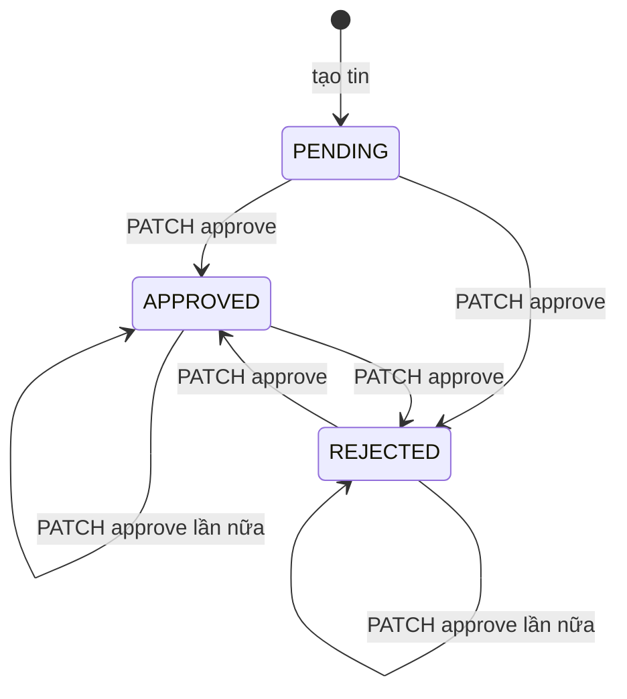
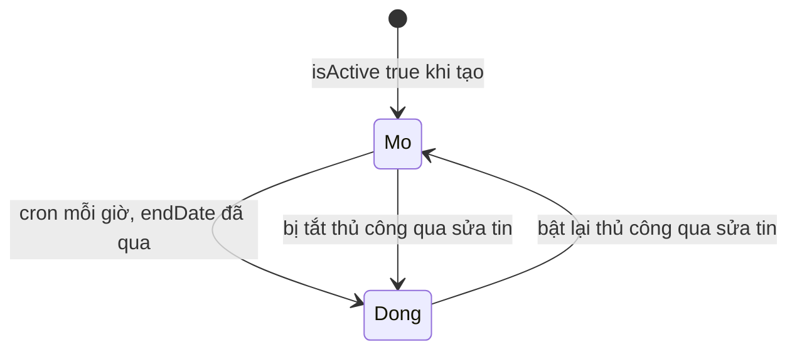

# State machine: duyệt tin và hiển thị tin nội bộ

Hai khía cạnh độc lập của một tin nội bộ: **trạng thái duyệt** (`approvalStatus`) và **trạng thái hoạt động** (`isActive`, kèm `endDate`). Tin chỉ hiển thị công khai khi cả hai đều thỏa.

## Trạng thái duyệt (`approvalStatus`)

Giá trị `EJobApprovalStatus`: `PENDING`, `APPROVED`, `REJECTED`.



`approveJob` ghi `approvalStatus` từ DTO mà **không kiểm tra trạng thái hiện tại** ([jobs.service.ts](../../../src/jobs/jobs.service.ts)), nhưng `ApproveJobDto` chỉ cho phép `APPROVED` hoặc `REJECTED` (`IsEnum` trên mảng `ALLOWED_STATUSES`, [approve-job.dto.ts](../../../src/jobs/dto/approve-job.dto.ts)). Hệ quả:

- Từ `PENDING` đi được tới `APPROVED` hoặc `REJECTED`.
- Từ `APPROVED` hoặc `REJECTED` đi được sang giá trị còn lại, hoặc ghi lại cùng giá trị.
- **Không có đường quay về `PENDING`** qua API: `PENDING` chỉ là giá trị ban đầu.

| Chuyển | Ai | Điều kiện | Ghi gì |
|---|---|---|---|
| tạo, thành `PENDING` | `HR` hoặc `SUPER ADMIN` | Mặc định; `approvalStatus` không nằm trong DTO tạo | |
| bất kỳ, thành `APPROVED` hoặc `REJECTED` | `SUPER ADMIN` | Tin tồn tại; `approvalNote` tối đa 500 ký tự | `approvalStatus`, `approvalNote`, `approvedBy`, `approvedAt`, `updatedBy`; xóa cache liên quan |

Sửa tin (`PATCH /jobs/:id`) **không** đổi `approvalStatus`.

## Trạng thái hoạt động (`isActive` và `endDate`)



| Chuyển | Cơ chế |
|---|---|
| `Mo` sang `Dong` do hết hạn | Cron `deactivate-expired-jobs` đặt `isActive = false` cho tin `isActive` có `endDate` ≤ hiện tại, xóa cache, gửi email cho người tạo ([jobs.service.ts](../../../src/jobs/jobs.service.ts)) |
| Bật hoặc tắt thủ công | Qua `PATCH /jobs/:id` vì `isActive` nằm trong `CreateJobDto`, kế thừa bởi `UpdateJobDto` |

Cron **không bao giờ bật lại** tin. Sửa `endDate` sang tương lai không tự đặt lại `isActive` thành `true`.

## Điều kiện hiển thị công khai

```text
công khai = isActive  VÀ  approvalStatus = APPROVED  VÀ  (endDate rỗng HOẶC endDate >= hiện tại)  VÀ  chưa xóa mềm
```

Nguồn: [job-visibility.util.ts](../../../src/jobs/job-visibility.util.ts), dùng chung cho `GET /jobs` và tìm kiếm hợp nhất.

## Edge case

| Tình huống | Hành vi |
|---|---|
| Tin hết hạn nhưng cron chưa chạy (tối đa khoảng 1 giờ) | Bộ lọc hiển thị cũng kiểm tra `endDate`, nên tin biến mất khỏi công khai ngay khi quá hạn |
| Tin `REJECTED` còn `isActive` | Không hiển thị công khai; HR của công ty vẫn thấy |
| Duyệt rồi HR sửa nội dung | Vẫn `APPROVED`, không qua duyệt lại |
| Người theo dõi công ty | Nhận email "tin mới" lúc **tạo** tin, trước khi duyệt ([jobs](../../03-modules/jobs.md#known-limitation)) |

## Known Limitation

Không có "gửi duyệt lại" khi sửa (tin đã duyệt vẫn `APPROVED` sau khi sửa và không có đường về `PENDING`), và không có lịch sử duyệt (chỉ giữ lần duyệt cuối trong `approvedBy`, `approvedAt`).
