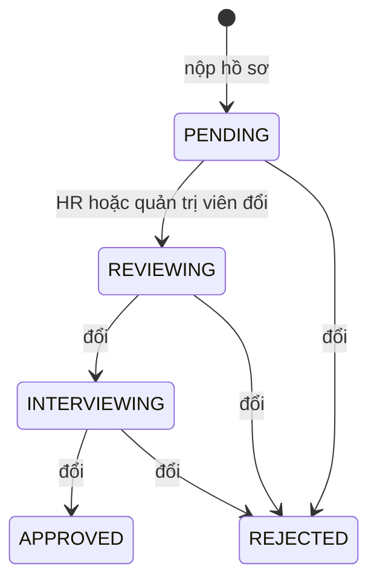

# State machine: trạng thái hồ sơ ứng tuyển (`resumes.status`)

Giá trị enum `EResumeStatus`: `PENDING`, `REVIEWING`, `INTERVIEWING`, `APPROVED`, `REJECTED`.

## Điều quan trọng nhất: code không ép thứ tự chuyển

`ResumesService.update` đặt `status` bằng giá trị gửi lên mà **không kiểm tra trạng thái hiện tại** ([resumes.service.ts](../../../src/resumes/resumes.service.ts)). Mọi chuyển đổi giữa năm trạng thái đều được chấp nhận, kể cả quay lại `PENDING` hay từ `REJECTED` sang `APPROVED`. Vì vậy sơ đồ dưới đây mô tả **luồng dự kiến theo tên trạng thái**, không phải ràng buộc được thực thi.

Chỉ mũi tên `[*] → PENDING` do code tạo ra. Các mũi tên còn lại là luồng hợp lý theo ý nghĩa tên gọi; mọi cặp trạng thái khác cũng hợp lệ về mặt kỹ thuật.

## Điều code thực sự làm

| Sự kiện | Hành vi | Nơi thực hiện |
|---|---|---|
| Nộp hồ sơ (`cv-online`, `upload-cv`, `create`) | `status = PENDING`, `histories` có một phần tử `PENDING` | `create`, [application-submission.service.ts](../../../src/resumes/services/application-submission.service.ts) |
| `PATCH /resumes/:id` có `status` | Ghi `status` mới, `$push` vào `histories` (`status`, `updatedAt`, `updatedBy`) | `update` |
| Sau khi đổi `status` | Gửi thông báo cho ứng viên bất đồng bộ; lỗi chỉ log | `sendStatusChangeNotification` |
| Chấm điểm xong | Chỉ đổi `priority`; **không** đổi `status` | `handleAnalyzeResume` (dòng gán `status` bị comment) |

Ai được đổi: `HR` (hồ sơ công ty mình) và `SUPER ADMIN`. Ứng viên không đổi được trạng thái hồ sơ của chính mình.

## Edge case

| Tình huống | Hành vi |
|---|---|
| Đổi sang cùng trạng thái hiện tại | Vẫn ghi thêm một phần tử `histories` và gửi thông báo |
| Hai người đổi cùng lúc | Không có khóa lạc quan; lần ghi sau thắng, `histories` có cả hai |
| `histories` tăng | Không có giới hạn kích thước |
| Hồ sơ bị xóa mềm | Không thuộc các trạng thái này; xem [resumes](../../04-database/collections/resumes.md) |

## Known Limitation

- Không có kiểm tra chuyển trạng thái (xem trên). Muốn bảo đảm luồng, cần thêm bảng chuyển hợp lệ trong `update`.
- Trạng thái tự động theo điểm đã có hàm nhưng đang tắt ([resumes](../../04-database/collections/resumes.md#quy-tắc-nghiệp-vụ)).
