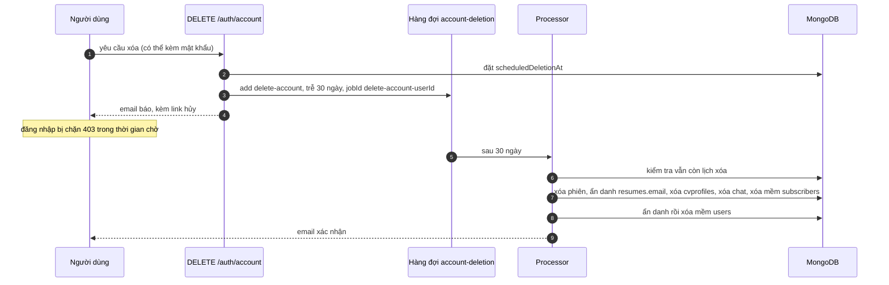

# Use case: xóa tài khoản

## Actor và mục đích

Người dùng muốn xóa tài khoản và dữ liệu cá nhân. Có 30 ngày chờ trước khi xóa thật để có thể đổi ý.

## Precondition và postcondition

| | Giá trị |
|---|---|
| Precondition | Đã đăng nhập; chưa có yêu cầu xóa đang chờ |
| Postcondition yêu cầu | `scheduledDeletionAt` = hiện tại + 30 ngày; việc `delete-account` trễ 30 ngày trong hàng đợi; email báo kèm link hủy |
| Postcondition xóa | Tài khoản bị ẩn danh và xóa mềm; một phần dữ liệu bị xóa |

## Luồng chính

## Luồng thay thế: hủy

| Cách | Hoạt động |
|---|---|
| Hủy khi đăng nhập | `POST /auth/account/cancel-deletion`. **Không dùng được**: người dùng đang chờ xóa bị `JwtStrategy` chặn `403`, nên không tới được route này ([known limitation](../../03-modules/auth-and-sessions.md#known-limitation)) |
| Hủy bằng token | `POST /auth/account/cancel-deletion-by-token` với token trong email. Token lưu trong bộ nhớ tiến trình (sống 30 ngày), mất khi backend khởi động lại |

Hủy thành công xóa việc theo `jobId`, gỡ `scheduledDeletionAt`.

## Luồng lỗi

| Tình huống | Kết quả |
|---|---|
| Token sai hoặc hết hạn | `400` "Invalid or expired cancellation token." |
| Hết thời gian chờ | `400` "The grace period has expired" |
| Không có yêu cầu đang chờ | `400` |
| Gửi email xác nhận lỗi | Chỉ log, xóa vẫn hoàn tất |

## Dữ liệu sau khi xóa

| Dữ liệu | Số phận |
|---|---|
| Phiên, CV trực tuyến, phiên chat và tin nhắn chat | Xóa thật |
| Đăng ký gợi ý | Xóa mềm theo email |
| `users` | Ẩn danh (`Deleted User`, email `deleted_<id>@deleted.invalid`), bỏ mật khẩu, ảnh, công ty, tin đã lưu, rồi xóa mềm |
| `resumes` | Chỉ `email` bị ẩn danh. `parsedData`, `cvStructuredData`, `url`, `createdBy.email`, `histories` **còn nguyên** |
| File CV và ảnh đã tải lên | **Không** bị xóa khỏi đĩa |
| `notifications`, `chat_tool_actions`, `ai_usage_logs` | **Không** bị xóa |

Đây là mô tả hành vi đọc từ [account-deletion-queue.processor.ts](../../../src/queues/processors/account-deletion-queue.processor.ts); chưa chạy thử. Tài liệu không đánh giá tuân thủ quy định bảo vệ dữ liệu. Chi tiết: [queues](../../03-modules/queues.md#account-deletion).

## Edge case

- Backend khởi động lại trong thời gian chờ: việc trễ vẫn nằm trong Redis, nhưng token hủy trong email có thể mất hiệu lực.
- Redis mất dữ liệu: lịch xóa mất theo, người dùng không bị xóa dù đã yêu cầu ([asynchronous-processing](../../02-architecture/asynchronous-processing.md#thời-gian-hẹn-giờ)).
- Email người dùng xuất hiện trong log lúc xóa.
