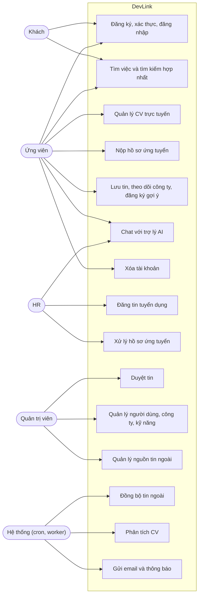

# Tổng quan use case

Các tác nhân (actor) và chức năng chính của DevLink. Mỗi nghiệp vụ phức tạp có tài liệu riêng bên dưới. Danh sách quyền theo vai trò: [user-roles](../../01-product/user-roles.md).

## Sơ đồ use case

HR cũng dùng được các chức năng của ứng viên (nộp hồ sơ, CV trực tuyến, đăng nhập) vì các route đó không giới hạn vai trò. Quản trị viên mở rộng được mọi chức năng của HR.

## Tài liệu từng nghiệp vụ

| Nghiệp vụ | Tài liệu |
|---|---|
| Đăng ký, xác thực, đăng nhập, quên mật khẩu | [authentication](authentication.md) |
| Đăng tin và duyệt tin | [job-posting-and-approval](job-posting-and-approval.md) |
| Nộp hồ sơ ứng tuyển | [job-application](job-application.md) |
| Quản lý CV trực tuyến | [cv-management](cv-management.md) |
| Xóa tài khoản | [account-deletion](account-deletion.md) |
| Đồng bộ tin ngoài | [sequence](../sequences/job-ingestion.md) |
| Chat AI | [sequence](../sequences/ai-chat-streaming.md) |
| Tìm kiếm hợp nhất | [sequence](../sequences/unified-job-search.md) |

Các sơ đồ trạng thái: [job-approval](../state-machines/job-approval.md), [resume-status](../state-machines/resume-status.md), [external-job-lifecycle](../state-machines/external-job-lifecycle.md).
