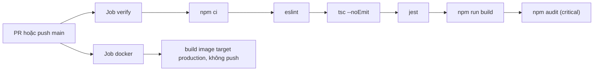
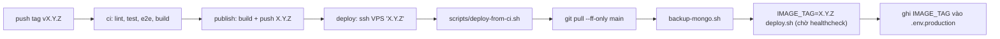

# CI/CD

Quy trình tích hợp liên tục chạy bằng GitHub Actions. Workflow `docker-publish.yml` build và đẩy image lên Docker Hub khi có tag `v*`, rồi tự triển khai bản đó lên VPS qua SSH (hai mục cuối).

## GitHub Actions

Nguồn: [.github/workflows/ci.yml](../../.github/workflows/ci.yml). Chạy khi có Pull Request và khi push lên `main`. Quyền `contents: read`. Một lần chạy mới hủy lần cũ trên cùng nhánh (`concurrency`).

| Job | Bước | Ghi chú |
|---|---|---|
| `verify` | `npm ci`, `eslint` trên `src, apps, libs, test`, `tsc --noEmit`, `jest`, `npm run build`, `npm audit --omit=dev --audit-level=critical` | Node theo `.nvmrc` (24), cache npm. Comment trong file: chỉ chặn mức `critical` cho tới khi nâng NestJS major xử lý các lỗi mức cao của express và multer |
| `docker` | Build image `production` bằng `docker/build-push-action`, `push: false`, cache GitHub Actions | Chỉ kiểm tra Dockerfile build được |

Các bước dùng action `checkout`, `setup-node`, `setup-buildx-action`, `build-push-action` ở các phiên bản chính ghi trong file.

### Những gì CI **không** làm

- Không chạy e2e (`npm run test:e2e` cần MongoDB và Redis, workflow không dựng service).
- Không đo độ bao phủ test hay đặt ngưỡng.
- Không quét image Docker hay quét bí mật.
- Không kiểm tra tài liệu (link, Mermaid); các script kiểm tra tài liệu chỉ chạy tay ([documentation-guide](../13-contributing/documentation-guide.md)).

## Git hook cục bộ

[Husky](../../.husky/): `pre-commit` chạy `lint-staged` (với `*.ts` chạy `eslint --fix`) và `commit-msg` chạy `commitlint` ([commitlint.config.js](../../commitlint.config.js)). Hook cài qua script `prepare` (`husky`).

## Dependabot

[.github/dependabot.yml](../../.github/dependabot.yml): hằng tuần cho `npm` (gộp minor và patch, tối đa 5 PR mở, bỏ qua major của `@nestjs/*` vì đi qua quy trình nâng cấp riêng), `docker` (bỏ qua major của `node`, chọn tay theo LTS), và `github-actions`.

## Đẩy image lên Docker Hub

Nguồn: [.github/workflows/docker-publish.yml](../../.github/workflows/docker-publish.yml). Chạy khi push tag `v*` hoặc bấm chạy tay (`workflow_dispatch`). Job đầu tiên `ci` gọi lại toàn bộ [ci.yml](../../.github/workflows/ci.yml) (`workflow_call`) trên đúng commit được tag; `publish` có `needs: ci`, nên tag gắn lên commit chưa qua test không được build hay deploy. Cần secret `DOCKERHUB_USERNAME`, `DOCKERHUB_TOKEN`; biến `IMAGE_NAME` là tùy chọn (mặc định `job-portal-be`).

| Tag sinh ra | Khi nào |
|---|---|
| `X.Y.Z` | Push tag `vX.Y.Z` |
| `sha-<short>` | Mọi lần chạy |
| `latest` | Chỉ khi chạy từ tag |

Chỉ build `linux/amd64`, target `production`.

## Triển khai tự động (CD)

Job `deploy` trong cùng workflow chạy sau `publish`, **chỉ khi chạy từ tag** (chạy tay từ một nhánh thì chỉ build image). Job dùng GitHub Environment `production` và không chạy song song hai lần deploy (`concurrency: deploy-production`).

| Cần có | Ở đâu |
|---|---|
| Secret `DEPLOY_SSH_KEY` (khóa riêng ed25519), `DEPLOY_HOST`, `DEPLOY_KNOWN_HOSTS` | Environment `production` |
| Biến `DEPLOY_USER` (tùy chọn, mặc định `root`) | Repository hoặc environment |
| Khóa công khai trong `authorized_keys` với `restrict,command="<repo>/scripts/deploy-from-ci.sh"` | VPS |

Khóa deploy bị ép chạy đúng [deploy-from-ci.sh](../../scripts/deploy-from-ci.sh): nó không mở được shell, và lệnh workflow gửi (`X.Y.Z`) chỉ đến script qua `$SSH_ORIGINAL_COMMAND`, bị từ chối nếu không đúng dạng semver. Host key được ghim qua `DEPLOY_KNOWN_HOSTS` (`StrictHostKeyChecking=yes`). Cài đặt một lần: [vps-production-guide](vps-production-guide.md#7-một-lần-bật-deploy-tự-động). Job `deploy` fail khi pull, sao lưu hay healthcheck lỗi; `.env.production` chỉ được ghi tag mới sau khi deploy thành công, nên khi lỗi file vẫn ghi đúng bản đang chạy. Job **không tự rollback** ([rollback](../11-operations/rollback.md)).

## Known Limitation

- Máy tài liệu này chạy Node 22 trong khi CI dùng Node 24 (`.nvmrc`); kết quả test cục bộ vẫn qua nhưng không thay cho CI.
- `npm audit` mức `critical` bỏ qua các lỗ hổng `high` đã biết trong phụ thuộc production.
- Không có môi trường staging; mỗi tag `v*` đi thẳng lên production (bật Required reviewers cho environment `production` nếu muốn duyệt tay trước khi deploy).

## Future Improvement

Đề xuất, chưa có: chạy e2e trong CI với service MongoDB và Redis; quét image và bí mật; đo coverage; kiểm tra tài liệu trong CI.
