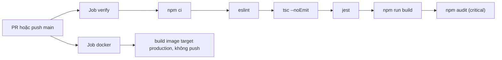

# CI/CD

Quy trình tích hợp liên tục chạy bằng GitHub Actions. Workflow `docker-publish.yml` build và đẩy image lên Docker Hub khi có tag `v*` (mục cuối). **Không có triển khai tự động (CD)** lên VPS: chạy tay `./scripts/deploy.sh` ([deployment](deployment.md)).

## GitHub Actions

Nguồn: [.github/workflows/ci.yml](../../.github/workflows/ci.yml). Chạy khi có Pull Request và khi push lên `main`. Quyền `contents: read`. Một lần chạy mới hủy lần cũ trên cùng nhánh (`concurrency`).

| Job | Bước | Ghi chú |
|---|---|---|
| `verify` | `npm ci`, `eslint` trên `src, apps, libs, test`, `tsc --noEmit`, `jest`, `npm run build`, `npm audit --omit=dev --audit-level=critical` | Node theo `.nvmrc` (24), cache npm. Comment trong file: chỉ chặn mức `critical` cho tới khi nâng NestJS major xử lý các lỗi mức cao của express và multer |
| `docker` | Build image `production` bằng `docker/build-push-action`, `push: false`, cache GitHub Actions | Chỉ kiểm tra Dockerfile build được |

Các bước dùng action `checkout`, `setup-node`, `setup-buildx-action`, `build-push-action` ở các phiên bản chính ghi trong file.

### Những gì CI **không** làm

- Không chạy e2e (`npm run test:e2e` cần MongoDB và Redis, workflow không dựng service).
- Không đo độ bao phủ test hay đặt ngưỡng.
- Không quét image Docker hay quét bí mật.
- Không kiểm tra tài liệu (link, Mermaid); các script kiểm tra tài liệu chỉ chạy tay ([documentation-guide](../13-contributing/documentation-guide.md)).
- Không triển khai tự động lên VPS (image chỉ được đẩy lên registry bởi `docker-publish.yml`).

## Git hook cục bộ

[Husky](../../.husky/): `pre-commit` chạy `lint-staged` (với `*.ts` chạy `eslint --fix`) và `commit-msg` chạy `commitlint` ([commitlint.config.js](../../commitlint.config.js)). Hook cài qua script `prepare` (`husky`).

## Dependabot

[.github/dependabot.yml](../../.github/dependabot.yml): hằng tuần cho `npm` (gộp minor và patch, tối đa 5 PR mở, bỏ qua major của `@nestjs/*` vì đi qua quy trình nâng cấp riêng), `docker` (bỏ qua major của `node`, chọn tay theo LTS), và `github-actions`.

## Đẩy image lên Docker Hub

Nguồn: [.github/workflows/docker-publish.yml](../../.github/workflows/docker-publish.yml). Chạy khi push tag `v*` hoặc bấm chạy tay (`workflow_dispatch`). Cần secret `DOCKERHUB_USERNAME`, `DOCKERHUB_TOKEN`; biến `IMAGE_NAME` là tùy chọn (mặc định `job-portal-be`).

| Tag sinh ra | Khi nào |
|---|---|
| `X.Y.Z` | Push tag `vX.Y.Z` |
| `sha-<short>` | Mọi lần chạy |
| `latest` | Chỉ khi chạy từ tag |

Chỉ build `linux/amd64`, target `production`. Workflow này **chưa được chạy thật** khi viết tài liệu (cần secrets và một tag).

## Known Limitation

- Máy tài liệu này chạy Node 22 trong khi CI dùng Node 24 (`.nvmrc`); kết quả test cục bộ vẫn qua nhưng không thay cho CI.
- `npm audit` mức `critical` bỏ qua các lỗ hổng `high` đã biết trong phụ thuộc production.
- Không có môi trường staging; triển khai lên VPS là thao tác tay.

## Future Improvement

Đề xuất, chưa có: chạy e2e trong CI với service MongoDB và Redis; quét image và bí mật; đo coverage; kiểm tra tài liệu trong CI.
