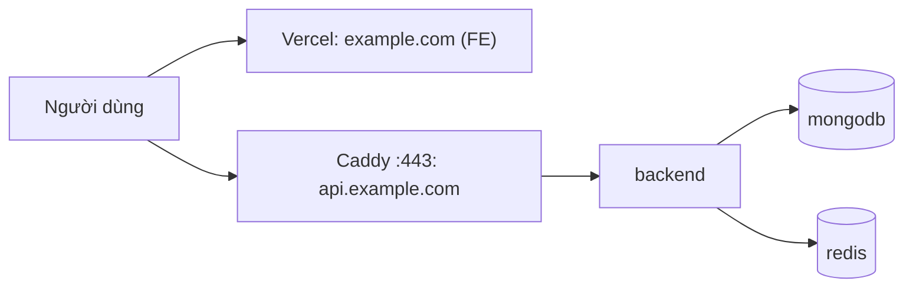

# Hướng dẫn deploy lên VPS 1.5GB và Vercel

BE, MongoDB, Redis và Caddy chạy trên VPS; FE chạy trên Vercel. Image BE build ở GitHub Actions, đẩy Docker Hub; VPS chỉ `pull`, không build. Trong tài liệu, `example.com` là domain của bạn.



Trạng thái kiểm chứng: stack compose (thứ tự khởi động, tự phục hồi, seed, `deploy.sh`, `backup-mongo.sh`) đã chạy thử trên Docker cục bộ. **Chưa kiểm chứng:** workflow Docker Hub, chứng chỉ Let's Encrypt với DNS thật, build `linux/amd64`, và RAM trên VPS thật.

## 1. Một lần: Docker Hub và GitHub

1. Tạo repository trên Docker Hub (ví dụ `job-portal-be`) và một access token (Account Settings, Security).
2. Trong repo GitHub, Settings, Secrets and variables, Actions: thêm secret `DOCKERHUB_USERNAME`, `DOCKERHUB_TOKEN`. Tùy chọn: biến `IMAGE_NAME` nếu khác `job-portal-be`.
3. Phát hành: `git tag v1.0.0 && git push origin v1.0.0`. Workflow [docker-publish.yml](../../.github/workflows/docker-publish.yml) đẩy `1.0.0`, `sha-<short>` và `latest`.

## 2. Chuẩn bị VPS (Ubuntu)

```bash
# Swap 2GB: RAM chỉ 1.5GB nên bắt buộc
sudo fallocate -l 2G /swapfile && sudo chmod 600 /swapfile
sudo mkswap /swapfile && sudo swapon /swapfile
echo '/swapfile none swap sw 0 0' | sudo tee -a /etc/fstab
echo 'vm.swappiness=10' | sudo tee /etc/sysctl.d/99-swap.conf && sudo sysctl --system

# Tường lửa
sudo ufw allow 22/tcp && sudo ufw allow 80/tcp && sudo ufw allow 443/tcp && sudo ufw enable
```

Cài Docker Engine kèm Compose plugin theo [hướng dẫn chính thức](https://docs.docker.com/engine/install/ubuntu/). Cổng do Docker publish bỏ qua `ufw`; compose production chỉ publish 80 và 443 (Caddy), đừng thêm cổng khác.

## 3. DNS tại nhà cung cấp tên miền

Trong trang quản lý DNS, thêm:

| Loại | Tên | Giá trị |
|---|---|---|
| A | `api` | IP của VPS |
| A | `@` | IP Vercel hiển thị ở Project, Settings, Domains |
| CNAME | `www` | Giá trị Vercel hiển thị |

Đợi DNS cập nhật (`dig +short api.example.com` trả về IP VPS) **trước** khi bật Caddy, vì Let's Encrypt cần xác thực qua cổng 80/443.

## 4. Cấu hình và chạy BE trên VPS

```bash
git clone <repo-url> /opt/job-portal-be && cd /opt/job-portal-be
cp .env.example .env.production && chmod 600 .env.production
```

Đặt trong `.env.production` (secret sinh bằng `openssl rand -hex 32`; mật khẩu Mongo và Redis dùng `openssl rand -hex 24`):

```dotenv
NODE_ENV=production
FE_URL=https://example.com
CORS_ORIGINS=https://example.com,https://www.example.com
TRUST_PROXY=1
DOCKERHUB_USER=<tài khoản Docker Hub>
IMAGE_NAME=job-portal-be
IMAGE_TAG=1.0.0
API_DOMAIN=api.example.com
```

cùng các biến bắt buộc còn lại ([environment-variables](../14-reference/environment-variables.md)), trong đó có `EMAIL_ADMIN` và `INIT_PASSWORD` (từ 12 ký tự) cho bước seed. Nếu repository Docker Hub là private, chạy `docker login` trên VPS một lần.

```bash
./scripts/deploy.sh
curl -s https://api.example.com/api/v1/health/ready
docker compose -f docker-compose.prod.yml --env-file .env.production run --rm backend \
  node dist/databases/seeds/run-seed.js      # tạo skills, job sources, admin (một lần)
docker stats --no-stream                      # kiểm tra RAM từng container
```

Thứ tự khởi động: mongodb và redis khỏe, rồi backend khỏe, rồi caddy. Container tự khởi động lại khi lỗi (`restart: unless-stopped`) và sau khi VPS reboot. Khi MongoDB mất kết nối, `/health/ready` trả `503` còn `/health/live` vẫn `200`, nên backend không bị restart vô ích; MongoDB về lại thì `ready` tự về `200`.

## 5. FE trên Vercel

1. Import repo FE vào Vercel (Framework: Next.js).
2. Environment Variables (Production): `NEXT_PUBLIC_API_URL=https://api.example.com`, `NEXT_PUBLIC_SITE_URL=https://example.com`, `NEXT_PUBLIC_GOOGLE_CLIENT_ID=<id>`. Biến `NEXT_PUBLIC_*` được nhúng lúc build, đổi giá trị thì phải deploy lại.
3. Gắn domain `example.com` và `www.example.com` ở Settings, Domains.
4. Google Cloud Console: thêm `https://example.com` vào Authorized JavaScript origins.
5. Cookie đăng nhập là `SameSite=Strict`, nên FE phải ở cùng site với API (`example.com`), không dùng `*.vercel.app`.

Vercel Hobby chỉ dành cho dự án phi thương mại; nếu thu phí hoặc chạy quảng cáo, cần gói Pro.

## 6. Vận hành

- **Cập nhật:** phát hành tag mới, sửa `IMAGE_TAG` trong `.env.production`, chạy `./scripts/deploy.sh`.
- **Rollback:** đổi `IMAGE_TAG` về tag cũ rồi `./scripts/deploy.sh` ([rollback](../11-operations/rollback.md)).
- **Backup:** thêm vào crontab `0 3 * * * /opt/job-portal-be/scripts/backup-mongo.sh`. Script giữ 7 ngày trong `backups/`. **Sao chép thư mục này ra nơi khác** (máy cá nhân, bucket): backup chỉ nằm trên VPS thì mất VPS là mất cả hai. Khôi phục: [backup-and-recovery](../11-operations/backup-and-recovery.md).
- **RAM:** dùng `docker stats` và `free -h`. Giới hạn trong compose (backend 450m, mongodb 450m, redis 96m, caddy 32m) là ước tính; khi chạy thử cục bộ không có tải, tổng mức dùng khoảng 330MB. Dùng swap liên tục nghĩa là cần nâng VPS hoặc chuyển MongoDB sang Atlas (chỉ đổi `MONGO_URL`).

## Known Limitation

- Giới hạn RAM chưa đo dưới tải thật trên VPS.
- Một VPS, một MongoDB, không replica: mất máy là gián đoạn dịch vụ.
- Không có triển khai tự động qua SSH; mỗi lần cập nhật chạy tay `./scripts/deploy.sh`.
- Image production nặng khoảng 919MB (chủ yếu `node_modules` 538MB, gồm các gói như `typescript` và `webpack` kéo vào qua phụ thuộc gián tiếp). Giảm cần đổi phụ thuộc của dự án.
